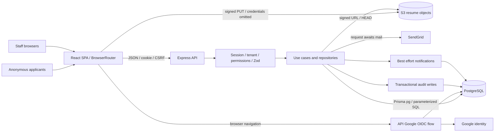

# 04 - System architecture

Analysis date: 2026-10-17. Static repository investigation; no application execution, dependency installation, migrations, services, or deployment. Source presence is not proof of runtime success.

## VERIFIED

A React SPA calls a modular Express monolith over HTTP JSON with cookie credentials and CSRF headers. PostgreSQL owns identity, recruiting state, idempotency, notifications and audit; S3 owns file bytes. Google supplies identity and SendGrid supplies mail. No durable worker boundary is implemented. [hiringloop-backend/src/app.js:1](../../hiringloop-backend/src/app.js#L1); [hiringloop-backend/src/database/client.js:1](../../hiringloop-backend/src/database/client.js#L1); [hiringloop-frontend/src/shared/lib/apiClient.ts:1](../../hiringloop-frontend/src/shared/lib/apiClient.ts#L1).

### Boundaries and failure propagation

Middleware order: correlation, exact-origin CORS, unsafe-method Origin check, 100kb JSON parsing, health/API, not-found, error handler. Tenant routes authenticate, check CSRF for writes, resolve membership, require permissions and parse inputs; ordering varies. Controllers map request context to use cases. ApplicationError becomes an error envelope with code/message/requestId/details; unknown failures expose generic 500. [hiringloop-backend/src/app.js:1](../../hiringloop-backend/src/app.js#L1); [hiringloop-backend/src/middleware/error-handler.js:1](../../hiringloop-backend/src/middleware/error-handler.js#L1).

Transactions protect job bootstrap, submissions, member invariants, offers/outcomes and selected audit writes. Audit receives the active transaction. Email dispatch occurs after Communication commit and is awaited by HTTP. Interview/feedback notifications run after persistence and log failures. [hiringloop-backend/src/modules/jobs/repositories/job-repository.js:83](../../hiringloop-backend/src/modules/jobs/repositories/job-repository.js#L83); [hiringloop-backend/src/modules/communications/candidate-communication-service.js:1](../../hiringloop-backend/src/modules/communications/candidate-communication-service.js#L1); [hiringloop-backend/src/modules/audit/repositories/audit-repository.js:16](../../hiringloop-backend/src/modules/audit/repositories/audit-repository.js#L16).

Organization is the tenant boundary; User is global; membership grants authority; Candidate differs from Application. Published versions/issued offers preserve historical definitions. Notification scope includes organization and recipient. SQL guards protect audit and supplement Prisma relationships. [hiringloop-backend/prisma/schema.prisma:1](../../hiringloop-backend/prisma/schema.prisma#L1); [hiringloop-backend/prisma/migrations/20260914120000_analytics_audit/migration.sql:41](../../hiringloop-backend/prisma/migrations/20260914120000_analytics_audit/migration.sql#L41).

## INFERRED

SPA assets, API process, DB and providers are separate operational boundaries. Domain integration uses in-process calls/SQL. Types and schemas duplicate contracts; no generated OpenAPI client found. Factory injection supports isolation but does not enforce import boundaries.

## NOT VERIFIED / UNKNOWN

No current runtime, database, browser, load, provider, or production verification was performed. Historical test results are documentation claims, not results reproduced by this investigation.

Ingress/TLS, replicas, DB grants, bucket policy and provider availability are unknown. Arrows are source call paths, not verified production connections.
