# 08 - Database architecture

**Phase 4B runtime follow-up (2026-10-18):** Local `hiringloop_test` now has 18 applied migrations with matching checksums and all 39 Prisma models' scalar columns present. A reproduced resume write failure was caused by the shared document/upload trigger referencing fields absent from the current `NEW` record, despite correct physical columns. An additive migration branches on table name before table-specific SQL; no model/table/constraint changes. Focused PostgreSQL resume persistence now passes 16 tests. See [27-resume-persistence-verification.md](27-resume-persistence-verification.md). The static baseline below remains historical.

Analysis date: 2026-10-17. Static repository investigation; no application execution, dependency installation, migrations, services, or deployment. Source presence is not proof of runtime success.

## VERIFIED

**39 Prisma models / 39 application CREATE TABLE definitions** are expected from the schema and checked migration catalog below. Prisma migration bookkeeping (_prisma_migrations) is excluded; actual live database tables/drift are UNKNOWN. PostgreSQL is authoritative; Prisma uses the pg driver adapter. UUIDv7 IDs are generated in application code, with timestamptz fields, restrictive domain deletes and cascade cleanup on selected auth/preference relations. [hiringloop-backend/prisma/schema.prisma:1](../../hiringloop-backend/prisma/schema.prisma#L1); [hiringloop-backend/src/database/client.js:1](../../hiringloop-backend/src/database/client.js#L1); [hiringloop-backend/src/utils/ids.js:1](../../hiringloop-backend/src/utils/ids.js#L1).

### Complete model / constraints / index inventory

| Model | Purpose / scalar fields | Declared uniqueness / indexes | Relations |
| --- | --- | --- | --- |
| [hiringloop-backend/prisma/schema.prisma:14](../../hiringloop-backend/prisma/schema.prisma#L14) | id                      String                   @id @db.Uuid; email                   String                   @unique; emailVerifiedAt         DateTime?                @db.Timestamptz(6); createdAt               DateTime                 @default(now()) @db.Timestamptz(6); updatedAt               DateTime                 @updatedAt @db.Timestamptz(6) |  | createdInterviews       Interview[]              @relation("InterviewCreatedBy"); cancelledInterviews     Interview[]              @relation("InterviewCancelledBy"); authoredNotes           Note[]                   @relation("NoteAuthor"); createdCommunications   Communication[]          @relation("CommunicationCreatedBy"); createdCommunicationTemplates CommunicationTemplate[] @relation("CommunicationTemplateCreatedBy"); notifications           Notification[]           @relation("NotificationRecipient"); createdOffers Offer[] @relation("OfferCreatedBy"); offerAcceptances Offer[] @relation("OfferAcceptedBy"); offerDeclines Offer[] @relation("OfferDeclinedBy"); offerWithdrawals Offer[] @relation("OfferWithdrawnBy"); createdOfferVersions OfferVersion[] @relation("OfferVersionCreatedBy"); createdTalentPools TalentPool[] @relation("TalentPoolCreatedBy"); addedTalentPoolMembers TalentPoolMember[] @relation("TalentPoolMemberAddedBy"); auditEventsAsActor AuditEvent[] @relation("AuditEventActor") |
| [hiringloop-backend/prisma/schema.prisma:44](../../hiringloop-backend/prisma/schema.prisma#L44) | id                String   @id @db.Uuid; userId            String   @unique @db.Uuid; passwordHash      String; passwordChangedAt DateTime @db.Timestamptz(6); createdAt         DateTime @default(now()) @db.Timestamptz(6); updatedAt         DateTime @updatedAt @db.Timestamptz(6) |  | user User @relation(fields: [userId], references: [id], onDelete: Cascade, onUpdate: Restrict) |
| [hiringloop-backend/prisma/schema.prisma:55](../../hiringloop-backend/prisma/schema.prisma#L55) | id                String    @id @db.Uuid; userId            String    @db.Uuid; sessionSecretHash String    @unique; expiresAt         DateTime  @db.Timestamptz(6); revokedAt         DateTime? @db.Timestamptz(6); createdAt         DateTime  @default(now()) @db.Timestamptz(6) | @@index([userId]); @@index([expiresAt]) | user User @relation(fields: [userId], references: [id], onDelete: Cascade, onUpdate: Restrict) |
| [hiringloop-backend/prisma/schema.prisma:74](../../hiringloop-backend/prisma/schema.prisma#L74) | id         String           @id @db.Uuid; userId     String           @db.Uuid; tokenHash  String           @unique; expiresAt  DateTime         @db.Timestamptz(6); consumedAt DateTime?        @db.Timestamptz(6); createdAt  DateTime         @default(now()) @db.Timestamptz(6) | @@index([userId, purpose, consumedAt]); @@index([expiresAt]) | user User @relation(fields: [userId], references: [id], onDelete: Cascade, onUpdate: Restrict) |
| [hiringloop-backend/prisma/schema.prisma:89](../../hiringloop-backend/prisma/schema.prisma#L89) | id              String   @id @db.Uuid; userId          String   @db.Uuid; provider        String   @db.VarChar(32); providerSubject String; createdAt       DateTime @default(now()) @db.Timestamptz(6); updatedAt       DateTime @updatedAt @db.Timestamptz(6) | @@unique([provider, providerSubject]); @@index([userId]) | user User @relation(fields: [userId], references: [id], onDelete: Cascade, onUpdate: Restrict) |
| [hiringloop-backend/prisma/schema.prisma:103](../../hiringloop-backend/prisma/schema.prisma#L103) | id          String                   @id @db.Uuid; name        String; slug        String                   @unique @db.VarChar(63); website     String?; description String?; createdAt   DateTime                 @default(now()) @db.Timestamptz(6); updatedAt   DateTime                 @updatedAt @db.Timestamptz(6) |  |  |
| [hiringloop-backend/prisma/schema.prisma:148](../../hiringloop-backend/prisma/schema.prisma#L148) | id           String         @id @db.Uuid; organizationId String       @db.Uuid; actorUserId  String?        @db.Uuid; action       String         @db.VarChar(64); resourceType String         @db.VarChar(64); resourceId   String         @db.Uuid; before       Json?; after        Json?; metadata     Json?; requestId    String?        @db.Uuid; occurredAt   DateTime       @default(now()) @db.Timestamptz(6); createdAt    DateTime       @default(now()) @db.Timestamptz(6) | @@index([organizationId, occurredAt, id]); @@index([organizationId, actorUserId, occurredAt, id]); @@index([organizationId, action, occurredAt, id]); @@index([organizationId, resourceType, resourceId, occurredAt, id]) | organization Organization @relation(fields: [organizationId], references: [id], onDelete: Restrict, onUpdate: Restrict); actor        User?        @relation("AuditEventActor", fields: [actorUserId], references: [id], onDelete: Restrict, onUpdate: Restrict) |
| [hiringloop-backend/prisma/schema.prisma:172](../../hiringloop-backend/prisma/schema.prisma#L172) | id             String   @id @db.Uuid; organizationId String   @db.Uuid; userId         String   @db.Uuid; role           String   @db.VarChar(32); createdAt      DateTime @default(now()) @db.Timestamptz(6); updatedAt      DateTime @updatedAt @db.Timestamptz(6) | @@unique([organizationId, userId]); @@index([userId]) | organization    Organization @relation(fields: [organizationId], references: [id], onDelete: Restrict, onUpdate: Restrict); user            User         @relation(fields: [userId], references: [id], onDelete: Restrict, onUpdate: Restrict); sentInvitations Invitation[] @relation("InvitationInviterMembership") |
| [hiringloop-backend/prisma/schema.prisma:189](../../hiringloop-backend/prisma/schema.prisma#L189) | id                  String    @id @db.Uuid; organizationId      String    @db.Uuid; email               String    @db.VarChar(320); role                String    @db.VarChar(32); tokenHash           String    @unique; expiresAt           DateTime  @db.Timestamptz(6); acceptedAt          DateTime? @db.Timestamptz(6); revokedAt           DateTime? @db.Timestamptz(6); inviterMembershipId String    @db.Uuid; createdAt           DateTime  @default(now()) @db.Timestamptz(6); updatedAt           DateTime  @updatedAt @db.Timestamptz(6) | @@index([organizationId, email]); @@index([organizationId, createdAt]) | organization      Organization           @relation(fields: [organizationId], references: [id], onDelete: Restrict, onUpdate: Restrict); inviterMembership OrganizationMembership @relation("InvitationInviterMembership", fields: [inviterMembershipId], references: [id], onDelete: Restrict, onUpdate: Restrict) |
| [hiringloop-backend/prisma/schema.prisma:236](../../hiringloop-backend/prisma/schema.prisma#L236) | id             String          @id @db.Uuid; organizationId String          @db.Uuid; title          String          @db.VarChar(160); department     String?         @db.VarChar(100); location       String?         @db.VarChar(160); description    String?         @db.Text; openings       Int             @default(1); openedAt       DateTime?       @db.Timestamptz(6); closedAt       DateTime?       @db.Timestamptz(6); archivedAt     DateTime?       @db.Timestamptz(6); version        Int             @default(1); createdAt      DateTime        @default(now()) @db.Timestamptz(6); updatedAt      DateTime        @updatedAt @db.Timestamptz(6) | @@index([organizationId, updatedAt]); @@index([organizationId, status, updatedAt]); @@index([organizationId, status, openedAt]) | organization Organization @relation(fields: [organizationId], references: [id], onDelete: Restrict, onUpdate: Restrict) |
| [hiringloop-backend/prisma/schema.prisma:266](../../hiringloop-backend/prisma/schema.prisma#L266) | id        String   @id @db.Uuid; jobId     String   @unique @db.Uuid; version   Int      @default(1); createdAt DateTime @default(now()) @db.Timestamptz(6); updatedAt DateTime @updatedAt @db.Timestamptz(6) |  | job    Job             @relation(fields: [jobId], references: [id], onDelete: Restrict, onUpdate: Restrict) |
| [hiringloop-backend/prisma/schema.prisma:277](../../hiringloop-backend/prisma/schema.prisma#L277) | id             String            @id @db.Uuid; pipelineId     String            @db.Uuid; name           String            @db.VarChar(80); normalizedName String            @db.VarChar(80); position       Int; createdAt      DateTime          @default(now()) @db.Timestamptz(6); updatedAt      DateTime          @updatedAt @db.Timestamptz(6) | @@unique([pipelineId, position]); @@unique([pipelineId, normalizedName]) | pipeline Pipeline @relation(fields: [pipelineId], references: [id], onDelete: Restrict, onUpdate: Restrict); currentApplications Application[] @relation("ApplicationCurrentStage"); stageHistoryTo ApplicationStageHistory[] @relation("ApplicationStageHistoryTo"); stageHistoryFrom ApplicationStageHistory[] @relation("ApplicationStageHistoryFrom") |
| [hiringloop-backend/prisma/schema.prisma:312](../../hiringloop-backend/prisma/schema.prisma#L312) | id              String @id @db.Uuid; organizationId  String @db.Uuid; jobId           String @unique @db.Uuid; activeVersionId String @unique @db.Uuid; createdAt       DateTime @default(now()) @db.Timestamptz(6); updatedAt       DateTime @updatedAt @db.Timestamptz(6) | @@index([organizationId, jobId]) | organization Organization @relation(fields: [organizationId], references: [id], onDelete: Restrict, onUpdate: Restrict); job          Job @relation(fields: [jobId], references: [id], onDelete: Restrict, onUpdate: Restrict); activeVersion ApplicationFormVersion @relation("ApplicationFormActiveVersion", fields: [activeVersionId], references: [id], onDelete: Restrict, onUpdate: Restrict); versions     ApplicationFormVersion[] @relation("ApplicationFormVersions") |
| [hiringloop-backend/prisma/schema.prisma:328](../../hiringloop-backend/prisma/schema.prisma#L328) | id                String @id @db.Uuid; organizationId    String @db.Uuid; applicationFormId String @db.Uuid; versionNumber     Int; revision          Int @default(1); publishedAt       DateTime? @db.Timestamptz(6); createdAt         DateTime @default(now()) @db.Timestamptz(6); updatedAt         DateTime @updatedAt @db.Timestamptz(6) | @@unique([applicationFormId, versionNumber]); @@index([applicationFormId, status]) | organization Organization @relation(fields: [organizationId], references: [id], onDelete: Restrict, onUpdate: Restrict); applicationForm ApplicationForm @relation("ApplicationFormVersions", fields: [applicationFormId], references: [id], onDelete: Restrict, onUpdate: Restrict); activeFor ApplicationForm? @relation("ApplicationFormActiveVersion") |
| [hiringloop-backend/prisma/schema.prisma:349](../../hiringloop-backend/prisma/schema.prisma#L349) | id                       String @id @db.Uuid; organizationId           String @db.Uuid; applicationFormVersionId String @db.Uuid; questionKey              String @db.VarChar(100); label                    String @db.VarChar(500); description              String? @db.Text; placeholder              String? @db.VarChar(500); required                 Boolean @default(false); sortOrder                Int; createdAt                DateTime @default(now()) @db.Timestamptz(6); updatedAt                DateTime @updatedAt @db.Timestamptz(6) | @@unique([applicationFormVersionId, questionKey]); @@index([applicationFormVersionId, sortOrder]) | organization Organization @relation(fields: [organizationId], references: [id], onDelete: Restrict, onUpdate: Restrict); applicationFormVersion ApplicationFormVersion @relation(fields: [applicationFormVersionId], references: [id], onDelete: Restrict, onUpdate: Restrict) |
| [hiringloop-backend/prisma/schema.prisma:372](../../hiringloop-backend/prisma/schema.prisma#L372) | id             String @id @db.Uuid; organizationId String @db.Uuid; questionId     String @db.Uuid; label          String @db.VarChar(500); value          String @db.VarChar(200); sortOrder      Int; createdAt      DateTime @default(now()) @db.Timestamptz(6); updatedAt      DateTime @updatedAt @db.Timestamptz(6) | @@unique([questionId, value]); @@index([questionId, sortOrder]) | organization Organization @relation(fields: [organizationId], references: [id], onDelete: Restrict, onUpdate: Restrict); question ApplicationFormQuestion @relation(fields: [questionId], references: [id], onDelete: Restrict, onUpdate: Restrict) |
| [hiringloop-backend/prisma/schema.prisma:399](../../hiringloop-backend/prisma/schema.prisma#L399) | id              String   @id @db.Uuid; organizationId  String   @db.Uuid; normalizedEmail String   @db.VarChar(320); email           String   @db.VarChar(320); firstName       String   @db.VarChar(100); lastName        String   @db.VarChar(100); phone           String?  @db.VarChar(50); createdAt       DateTime @default(now()) @db.Timestamptz(6); updatedAt       DateTime @updatedAt @db.Timestamptz(6) | @@unique([organizationId, normalizedEmail]); @@unique([id, organizationId]) | organization Organization @relation(fields: [organizationId], references: [id], onDelete: Restrict, onUpdate: Restrict) |
| [hiringloop-backend/prisma/schema.prisma:312](../../hiringloop-backend/prisma/schema.prisma#L312) | id                       String   @id @db.Uuid; organizationId           String   @db.Uuid; jobId                    String   @db.Uuid; candidateId              String   @db.Uuid; applicationFormVersionId String   @db.Uuid; currentPipelineStageId   String   @db.Uuid; submittedFirstName       String   @db.VarChar(100); submittedLastName        String   @db.VarChar(100); submittedEmail           String   @db.VarChar(320); submittedPhone           String?  @db.VarChar(50); idempotencyKey           String   @db.Uuid; requestFingerprint       String   @db.Char(64); outcomeUpdatedAt         DateTime @default(now()) @db.Timestamptz(6); outcomeRevision          Int @default(1); submittedAt              DateTime @default(now()) @db.Timestamptz(6); createdAt                DateTime @default(now()) @db.Timestamptz(6); updatedAt                DateTime @updatedAt @db.Timestamptz(6) | @@unique([organizationId, jobId, candidateId]); @@unique([organizationId, jobId, idempotencyKey]); @@unique([id, organizationId]); @@index([organizationId, jobId, submittedAt]); @@index([applicationFormVersionId]); @@index([currentPipelineStageId]) | organization Organization           @relation(fields: [organizationId], references: [id], onDelete: Restrict, onUpdate: Restrict); job          Job                    @relation(fields: [jobId], references: [id], onDelete: Restrict, onUpdate: Restrict); candidate    Candidate              @relation(fields: [candidateId], references: [id], onDelete: Restrict, onUpdate: Restrict); formVersion  ApplicationFormVersion @relation(fields: [applicationFormVersionId], references: [id], onDelete: Restrict, onUpdate: Restrict); currentStage PipelineStage          @relation("ApplicationCurrentStage", fields: [currentPipelineStageId], references: [id], onDelete: Restrict, onUpdate: Restrict); consumedUpload ApplicationUpload? @relation("ConsumedApplicationUpload"); talentPoolMembershipSources TalentPoolMember[] @relation("TalentPoolMemberSourceApplication") |
| [hiringloop-backend/prisma/schema.prisma:482](../../hiringloop-backend/prisma/schema.prisma#L482) | id String @id @db.Uuid; organizationId String @db.Uuid; applicationId String @unique @db.Uuid; currentVersionId String? @unique @db.Uuid; createdByUserId String @db.Uuid; sentAt DateTime? @db.Timestamptz(6); acceptedAt DateTime? @db.Timestamptz(6); declinedAt DateTime? @db.Timestamptz(6); withdrawnAt DateTime? @db.Timestamptz(6); acceptedByUserId String? @db.Uuid; declinedByUserId String? @db.Uuid; withdrawnByUserId String? @db.Uuid; revision Int @default(1); createdAt DateTime @default(now()) @db.Timestamptz(6); updatedAt DateTime @updatedAt @db.Timestamptz(6) | @@unique([id, organizationId]); @@unique([applicationId, organizationId]); @@index([organizationId, applicationId]) | organization Organization @relation(fields:[organizationId], references:[id], onDelete: Restrict, onUpdate: Restrict); application Application @relation(fields:[applicationId, organizationId], references:[id, organizationId], onDelete: Restrict, onUpdate: Restrict); currentVersion OfferVersion? @relation("OfferCurrentVersion", fields:[currentVersionId], references:[id], onDelete: Restrict, onUpdate: Restrict); versions OfferVersion[] @relation("OfferVersions"); createdBy User @relation("OfferCreatedBy", fields:[createdByUserId], references:[id], onDelete: Restrict, onUpdate: Restrict); acceptedBy User? @relation("OfferAcceptedBy", fields:[acceptedByUserId], references:[id], onDelete: Restrict, onUpdate: Restrict); declinedBy User? @relation("OfferDeclinedBy", fields:[declinedByUserId], references:[id], onDelete: Restrict, onUpdate: Restrict); withdrawnBy User? @relation("OfferWithdrawnBy", fields:[withdrawnByUserId], references:[id], onDelete: Restrict, onUpdate: Restrict) |
| [hiringloop-backend/prisma/schema.prisma:512](../../hiringloop-backend/prisma/schema.prisma#L512) | id String @id @db.Uuid; organizationId String @db.Uuid; offerId String @db.Uuid; versionNumber Int; jobTitle String @db.VarChar(160); currency String @db.Char(3); baseCompensationMinor BigInt @db.BigInt; bonusCompensationMinor BigInt? @db.BigInt; additionalCompensationText String? @db.Text; startDate DateTime? @db.Date; expirationDate DateTime? @db.Date; location String? @db.VarChar(160); additionalTerms String? @db.Text; revision Int @default(1); issuedAt DateTime? @db.Timestamptz(6); createdByUserId String @db.Uuid; createdAt DateTime @default(now()) @db.Timestamptz(6); updatedAt DateTime @updatedAt @db.Timestamptz(6) | @@unique([offerId, versionNumber]); @@unique([id, organizationId]); @@index([offerId, versionNumber]) | organization Organization @relation(fields:[organizationId], references:[id], onDelete: Restrict, onUpdate: Restrict); offer Offer @relation("OfferVersions", fields:[offerId, organizationId], references:[id, organizationId], onDelete: Restrict, onUpdate: Restrict); currentFor Offer? @relation("OfferCurrentVersion"); createdBy User @relation("OfferVersionCreatedBy", fields:[createdByUserId], references:[id], onDelete: Restrict, onUpdate: Restrict) |
| [hiringloop-backend/prisma/schema.prisma:542](../../hiringloop-backend/prisma/schema.prisma#L542) | id String @id @db.Uuid; organizationId String @db.Uuid; applicationId String @db.Uuid; reasonCode String? @db.VarChar(64); reasonDetails String? @db.VarChar(1000); actorUserId String @db.Uuid; occurredAt DateTime @default(now()) @db.Timestamptz(6); createdAt DateTime @default(now()) @db.Timestamptz(6) | @@index([applicationId, occurredAt, id]) | organization Organization @relation(fields:[organizationId], references:[id], onDelete: Restrict, onUpdate: Restrict); application Application @relation(fields:[applicationId, organizationId], references:[id, organizationId], onDelete: Restrict, onUpdate: Restrict); actor User @relation(fields:[actorUserId], references:[id], onDelete: Restrict, onUpdate: Restrict) |
| [hiringloop-backend/prisma/schema.prisma:558](../../hiringloop-backend/prisma/schema.prisma#L558) | id String @id @db.Uuid; organizationId String @db.Uuid; name String @db.VarChar(160); description String? @db.VarChar(1000); createdByUserId String @db.Uuid; revision Int @default(1); createdAt DateTime @default(now()) @db.Timestamptz(6); updatedAt DateTime @updatedAt @db.Timestamptz(6) | @@unique([organizationId, name]); @@unique([id, organizationId]); @@index([organizationId, name, id]) | organization Organization @relation(fields:[organizationId], references:[id], onDelete: Restrict, onUpdate: Restrict); createdBy User @relation("TalentPoolCreatedBy", fields:[createdByUserId], references:[id], onDelete: Restrict, onUpdate: Restrict) |
| [hiringloop-backend/prisma/schema.prisma:575](../../hiringloop-backend/prisma/schema.prisma#L575) | id String @id @db.Uuid; organizationId String @db.Uuid; talentPoolId String @db.Uuid; candidateId String @db.Uuid; sourceApplicationId String? @db.Uuid; addedByUserId String @db.Uuid; note String? @db.VarChar(1000); createdAt DateTime @default(now()) @db.Timestamptz(6) | @@unique([talentPoolId, candidateId]); @@index([talentPoolId, createdAt, id]); @@index([organizationId, candidateId]) | organization Organization @relation(fields:[organizationId], references:[id], onDelete: Restrict, onUpdate: Restrict); talentPool TalentPool @relation(fields:[talentPoolId, organizationId], references:[id, organizationId], onDelete: Restrict, onUpdate: Restrict); candidate Candidate @relation(fields:[candidateId, organizationId], references:[id, organizationId], onDelete: Restrict, onUpdate: Restrict); sourceApplication Application? @relation("TalentPoolMemberSourceApplication", fields:[sourceApplicationId, organizationId], references:[id, organizationId], onDelete: Restrict, onUpdate: Restrict); addedBy User @relation("TalentPoolMemberAddedBy", fields:[addedByUserId], references:[id], onDelete: Restrict, onUpdate: Restrict) |
| [hiringloop-backend/prisma/schema.prisma:594](../../hiringloop-backend/prisma/schema.prisma#L594) | id             String   @id @db.Uuid; organizationId String   @db.Uuid; applicationId  String   @db.Uuid; questionId     String   @db.Uuid; value          Json; createdAt      DateTime @default(now()) @db.Timestamptz(6); updatedAt      DateTime @updatedAt @db.Timestamptz(6) | @@unique([applicationId, questionId]); @@index([questionId]) | organization Organization            @relation(fields: [organizationId], references: [id], onDelete: Restrict, onUpdate: Restrict); application  Application             @relation(fields: [applicationId], references: [id], onDelete: Restrict, onUpdate: Restrict); question     ApplicationFormQuestion @relation(fields: [questionId], references: [id], onDelete: Restrict, onUpdate: Restrict) |
| [hiringloop-backend/prisma/schema.prisma:611](../../hiringloop-backend/prisma/schema.prisma#L611) | id               String                @id @db.Uuid; organizationId   String                @db.Uuid; candidateId      String                @db.Uuid; applicationId    String                @db.Uuid; objectKey        String                @unique @db.VarChar(512); originalFilename String                @db.VarChar(255); mimeType         String                @db.VarChar(127); sizeBytes        Int; createdAt        DateTime              @default(now()) @db.Timestamptz(6); updatedAt        DateTime              @updatedAt @db.Timestamptz(6) | @@index([organizationId, candidateId]); @@index([applicationId]) | organization Organization @relation(fields: [organizationId], references: [id], onDelete: Restrict, onUpdate: Restrict); candidate    Candidate    @relation(fields: [candidateId], references: [id], onDelete: Restrict, onUpdate: Restrict); application  Application  @relation(fields: [applicationId], references: [id], onDelete: Restrict, onUpdate: Restrict) |
| [hiringloop-backend/prisma/schema.prisma:632](../../hiringloop-backend/prisma/schema.prisma#L632) | id                    String                  @id @db.Uuid; organizationId        String                  @db.Uuid; jobId                 String                  @db.Uuid; objectKey             String                  @unique @db.VarChar(512); originalFilename      String                  @db.VarChar(255); mimeType              String                  @db.VarChar(127); declaredSizeBytes     Int; expiresAt             DateTime                @db.Timestamptz(6); consumedAt            DateTime?               @db.Timestamptz(6); consumedApplicationId String?                 @unique @db.Uuid; createdAt             DateTime                @default(now()) @db.Timestamptz(6); updatedAt             DateTime                @updatedAt @db.Timestamptz(6) | @@index([organizationId, jobId, status, expiresAt]); @@index([expiresAt]) | organization        Organization @relation(fields: [organizationId], references: [id], onDelete: Restrict, onUpdate: Restrict); job                 Job          @relation(fields: [jobId], references: [id], onDelete: Restrict, onUpdate: Restrict); consumedApplication Application? @relation("ConsumedApplicationUpload", fields: [consumedApplicationId], references: [id], onDelete: Restrict, onUpdate: Restrict) |
| [hiringloop-backend/prisma/schema.prisma:655](../../hiringloop-backend/prisma/schema.prisma#L655) | id             String   @id @db.Uuid; organizationId String   @db.Uuid; applicationId  String   @db.Uuid; fromStageId    String?  @db.Uuid; toStageId      String   @db.Uuid; event          String   @db.VarChar(64); occurredAt     DateTime @default(now()) @db.Timestamptz(6); createdAt      DateTime @default(now()) @db.Timestamptz(6) | @@index([applicationId, occurredAt]) | organization Organization  @relation(fields: [organizationId], references: [id], onDelete: Restrict, onUpdate: Restrict); application  Application   @relation(fields: [applicationId], references: [id], onDelete: Restrict, onUpdate: Restrict); fromStage    PipelineStage? @relation("ApplicationStageHistoryFrom", fields: [fromStageId], references: [id], onDelete: Restrict, onUpdate: Restrict); toStage      PipelineStage  @relation("ApplicationStageHistoryTo", fields: [toStageId], references: [id], onDelete: Restrict, onUpdate: Restrict) |
| [hiringloop-backend/prisma/schema.prisma:684](../../hiringloop-backend/prisma/schema.prisma#L684) | id                 String          @id @db.Uuid; organizationId     String          @db.Uuid; applicationId      String          @db.Uuid; title              String          @db.VarChar(160); scheduledStartAt   DateTime        @db.Timestamptz(6); scheduledEndAt     DateTime        @db.Timestamptz(6); timeZone           String          @db.VarChar(64); meetingUrl         String?         @db.VarChar(2048); location           String?         @db.VarChar(240); cancelledAt        DateTime?       @db.Timestamptz(6); cancelledByUserId  String?         @db.Uuid; cancellationReason String?         @db.VarChar(500); createdByUserId    String          @db.Uuid; createdAt          DateTime        @default(now()) @db.Timestamptz(6); updatedAt          DateTime        @updatedAt @db.Timestamptz(6) | @@unique([id, organizationId]); @@index([organizationId, scheduledStartAt]); @@index([applicationId, scheduledStartAt]) | organization Organization @relation(fields: [organizationId], references: [id], onDelete: Restrict, onUpdate: Restrict); application  Application  @relation(fields: [applicationId, organizationId], references: [id, organizationId], onDelete: Restrict, onUpdate: Restrict); createdBy    User         @relation("InterviewCreatedBy", fields: [createdByUserId], references: [id], onDelete: Restrict, onUpdate: Restrict); cancelledBy  User?        @relation("InterviewCancelledBy", fields: [cancelledByUserId], references: [id], onDelete: Restrict, onUpdate: Restrict) |
| [hiringloop-backend/prisma/schema.prisma:716](../../hiringloop-backend/prisma/schema.prisma#L716) | id          String   @id @db.Uuid; interviewId String   @db.Uuid; userId      String   @db.Uuid; createdAt   DateTime @default(now()) @db.Timestamptz(6) | @@unique([interviewId, userId]); @@index([userId, interviewId]) | interview Interview @relation(fields: [interviewId], references: [id], onDelete: Restrict, onUpdate: Restrict); user      User      @relation(fields: [userId], references: [id], onDelete: Restrict, onUpdate: Restrict) |
| [hiringloop-backend/prisma/schema.prisma:750](../../hiringloop-backend/prisma/schema.prisma#L750) | id String @id @db.Uuid; organizationId String @db.Uuid; jobId String @unique @db.Uuid; activeVersionId String? @unique @db.Uuid; createdAt DateTime @default(now()) @db.Timestamptz(6); updatedAt DateTime @updatedAt @db.Timestamptz(6) | @@index([organizationId, jobId]) | organization Organization @relation(fields: [organizationId], references: [id], onDelete: Restrict, onUpdate: Restrict); job Job @relation(fields: [jobId], references: [id], onDelete: Restrict, onUpdate: Restrict); activeVersion ScorecardTemplateVersion? @relation("ScorecardTemplateActiveVersion", fields: [activeVersionId], references: [id], onDelete: Restrict, onUpdate: Restrict); versions ScorecardTemplateVersion[] @relation("ScorecardTemplateVersions") |
| [hiringloop-backend/prisma/schema.prisma:764](../../hiringloop-backend/prisma/schema.prisma#L764) | id String @id @db.Uuid; organizationId String @db.Uuid; templateId String @db.Uuid; versionNumber Int; title String @db.VarChar(160); instructions String? @db.Text; revision Int @default(1); publishedAt DateTime? @db.Timestamptz(6); createdByUserId String @db.Uuid; createdAt DateTime @default(now()) @db.Timestamptz(6); updatedAt DateTime @updatedAt @db.Timestamptz(6) | @@unique([templateId, versionNumber]); @@index([templateId, status]) | organization Organization @relation(fields: [organizationId], references: [id], onDelete: Restrict, onUpdate: Restrict); template ScorecardTemplate @relation("ScorecardTemplateVersions", fields: [templateId], references: [id], onDelete: Restrict, onUpdate: Restrict); activeFor ScorecardTemplate? @relation("ScorecardTemplateActiveVersion") |
| [hiringloop-backend/prisma/schema.prisma:786](../../hiringloop-backend/prisma/schema.prisma#L786) | id String @id @db.Uuid; organizationId String @db.Uuid; templateVersionId String @db.Uuid; label String @db.VarChar(300); description String? @db.Text; required Boolean @default(false); position Int; createdAt DateTime @default(now()) @db.Timestamptz(6); updatedAt DateTime @updatedAt @db.Timestamptz(6) | @@unique([templateVersionId, position]) | organization Organization @relation(fields: [organizationId], references: [id], onDelete: Restrict, onUpdate: Restrict); templateVersion ScorecardTemplateVersion @relation(fields: [templateVersionId], references: [id], onDelete: Restrict, onUpdate: Restrict) |
| [hiringloop-backend/prisma/schema.prisma:750](../../hiringloop-backend/prisma/schema.prisma#L750) | id String @id @db.Uuid; organizationId String @db.Uuid; interviewId String @db.Uuid; interviewParticipantId String @unique @db.Uuid; templateVersionId String @db.Uuid; overallComment String? @db.Text; revision Int @default(1); submittedAt DateTime? @db.Timestamptz(6); createdAt DateTime @default(now()) @db.Timestamptz(6); updatedAt DateTime @updatedAt @db.Timestamptz(6) | @@index([organizationId, interviewId, status]); @@index([interviewId]) | organization Organization @relation(fields: [organizationId], references: [id], onDelete: Restrict, onUpdate: Restrict); interview Interview @relation(fields: [interviewId], references: [id], onDelete: Restrict, onUpdate: Restrict); participant InterviewParticipant @relation(fields: [interviewParticipantId], references: [id], onDelete: Restrict, onUpdate: Restrict); templateVersion ScorecardTemplateVersion @relation(fields: [templateVersionId], references: [id], onDelete: Restrict, onUpdate: Restrict) |
| [hiringloop-backend/prisma/schema.prisma:825](../../hiringloop-backend/prisma/schema.prisma#L825) | id String @id @db.Uuid; organizationId String @db.Uuid; scorecardId String @db.Uuid; criterionId String @db.Uuid; ratingValue Int?; textValue String? @db.Text; comment String? @db.Text; createdAt DateTime @default(now()) @db.Timestamptz(6); updatedAt DateTime @updatedAt @db.Timestamptz(6) | @@unique([scorecardId, criterionId]) | organization Organization @relation(fields: [organizationId], references: [id], onDelete: Restrict, onUpdate: Restrict); scorecard Scorecard @relation(fields: [scorecardId], references: [id], onDelete: Restrict, onUpdate: Restrict); criterion ScorecardCriterion @relation(fields: [criterionId], references: [id], onDelete: Restrict, onUpdate: Restrict) |
| [hiringloop-backend/prisma/schema.prisma:841](../../hiringloop-backend/prisma/schema.prisma#L841) | id String @id @db.Uuid; organizationId String @db.Uuid; applicationId String @db.Uuid; authorUserId String @db.Uuid; body String @db.Text; revision Int @default(1); createdAt DateTime @default(now()) @db.Timestamptz(6); updatedAt DateTime @updatedAt @db.Timestamptz(6) | @@index([organizationId, applicationId, createdAt]) | organization Organization @relation(fields: [organizationId], references: [id], onDelete: Restrict, onUpdate: Restrict); application Application @relation(fields: [applicationId], references: [id], onDelete: Restrict, onUpdate: Restrict); author User @relation("NoteAuthor", fields: [authorUserId], references: [id], onDelete: Restrict, onUpdate: Restrict) |
| [hiringloop-backend/prisma/schema.prisma:875](../../hiringloop-backend/prisma/schema.prisma#L875) | id String @id @db.Uuid; organizationId String @db.Uuid; applicationId String @db.Uuid; createdByUserId String @db.Uuid; recipientEmail String @db.VarChar(320); subject String @db.VarChar(998); body String @db.Text; provider String @db.VarChar(32); providerMessageId String? @db.VarChar(255); failureCategory String? @db.VarChar(64); idempotencyKey String @db.Uuid; payloadHash String @db.VarChar(64); offerVersionId String? @db.Uuid; sentAt DateTime? @db.Timestamptz(6); failedAt DateTime? @db.Timestamptz(6); createdAt DateTime @default(now()) @db.Timestamptz(6); updatedAt DateTime @updatedAt @db.Timestamptz(6) | @@unique([organizationId, applicationId, createdByUserId, idempotencyKey]); @@index([organizationId, applicationId, createdAt, id]) | organization Organization @relation(fields:[organizationId], references:[id], onDelete: Restrict, onUpdate: Restrict); application Application @relation(fields:[applicationId, organizationId], references:[id, organizationId], onDelete: Restrict, onUpdate: Restrict); createdBy User @relation("CommunicationCreatedBy", fields:[createdByUserId], references:[id], onDelete: Restrict, onUpdate: Restrict); offerVersion OfferVersion? @relation(fields:[offerVersionId, organizationId], references:[id, organizationId], onDelete: Restrict, onUpdate: Restrict) |
| [hiringloop-backend/prisma/schema.prisma:904](../../hiringloop-backend/prisma/schema.prisma#L904) | id String @id @db.Uuid; organizationId String @db.Uuid; name String @db.VarChar(160); subject String @db.VarChar(998); body String @db.Text; createdByUserId String @db.Uuid; revision Int @default(1); createdAt DateTime @default(now()) @db.Timestamptz(6); updatedAt DateTime @updatedAt @db.Timestamptz(6) | @@unique([organizationId, name]); @@index([organizationId, name]) | organization Organization @relation(fields:[organizationId], references:[id], onDelete: Restrict, onUpdate: Restrict); createdBy User @relation("CommunicationTemplateCreatedBy", fields:[createdByUserId], references:[id], onDelete: Restrict, onUpdate: Restrict) |
| [hiringloop-backend/prisma/schema.prisma:920](../../hiringloop-backend/prisma/schema.prisma#L920) | id String @id @db.Uuid; organizationId String @db.Uuid; recipientUserId String @db.Uuid; title String @db.VarChar(160); message String @db.VarChar(1000); applicationId String? @db.Uuid; interviewId String? @db.Uuid; readAt DateTime? @db.Timestamptz(6); createdAt DateTime @default(now()) @db.Timestamptz(6) | @@index([organizationId, recipientUserId, createdAt, id]) | organization Organization @relation(fields:[organizationId], references:[id], onDelete: Restrict, onUpdate: Restrict); recipient User @relation("NotificationRecipient", fields:[recipientUserId], references:[id], onDelete: Restrict, onUpdate: Restrict); application Application? @relation(fields:[applicationId, organizationId], references:[id, organizationId], onDelete: Restrict, onUpdate: Restrict); interview Interview? @relation(fields:[interviewId, organizationId], references:[id, organizationId], onDelete: Restrict, onUpdate: Restrict) |
| [hiringloop-backend/prisma/schema.prisma:938](../../hiringloop-backend/prisma/schema.prisma#L938) | id String @id @db.Uuid; organizationId String @db.Uuid; userId String @db.Uuid; enabled Boolean @default(true); createdAt DateTime @default(now()) @db.Timestamptz(6); updatedAt DateTime @updatedAt @db.Timestamptz(6) | @@unique([organizationId, userId, notificationType]) | organization Organization @relation(fields:[organizationId], references:[id], onDelete: Restrict, onUpdate: Restrict); user User @relation(fields:[userId], references:[id], onDelete: Restrict, onUpdate: Restrict); membership OrganizationMembership @relation(fields:[organizationId, userId], references:[organizationId, userId], onDelete: Cascade, onUpdate: Restrict) |

### Relationship diagram

Relationships below are generated from scalar relation fields in schema.prisma. Additional ownership checks/composite foreign keys exist in SQL migrations. Repeated arrows identify different role fields; the diagram is logical and is not a live DB introspection.

```mermaid
erDiagram
  User {
    UUID id PK
  }
  PasswordCredential {
    UUID id PK
  }
  AuthSession {
    UUID id PK
  }
  AuthToken {
    UUID id PK
  }
  AuthProviderIdentity {
    UUID id PK
  }
  Organization {
    UUID id PK
  }
  AuditEvent {
    UUID id PK
  }
  OrganizationMembership {
    UUID id PK
  }
  Invitation {
    UUID id PK
  }
  Job {
    UUID id PK
  }
  Pipeline {
    UUID id PK
  }
  PipelineStage {
    UUID id PK
  }
  ApplicationForm {
    UUID id PK
  }
  ApplicationFormVersion {
    UUID id PK
  }
  ApplicationFormQuestion {
    UUID id PK
  }
  ApplicationFormQuestionOption {
    UUID id PK
  }
  Candidate {
    UUID id PK
  }
  Application {
    UUID id PK
  }
  Offer {
    UUID id PK
  }
  OfferVersion {
    UUID id PK
  }
  ApplicationOutcomeEvent {
    UUID id PK
  }
  TalentPool {
    UUID id PK
  }
  TalentPoolMember {
    UUID id PK
  }
  ApplicationAnswer {
    UUID id PK
  }
  CandidateDocument {
    UUID id PK
  }
  ApplicationUpload {
    UUID id PK
  }
  ApplicationStageHistory {
    UUID id PK
  }
  Interview {
    UUID id PK
  }
  InterviewParticipant {
    UUID id PK
  }
  ScorecardTemplate {
    UUID id PK
  }
  ScorecardTemplateVersion {
    UUID id PK
  }
  ScorecardCriterion {
    UUID id PK
  }
  Scorecard {
    UUID id PK
  }
  ScorecardResponse {
    UUID id PK
  }
  Note {
    UUID id PK
  }
  Communication {
    UUID id PK
  }
  CommunicationTemplate {
    UUID id PK
  }
  Notification {
    UUID id PK
  }
  NotificationPreference {
    UUID id PK
  }
  User ||--o| PasswordCredential : user
  User ||--o{ AuthSession : user
  User ||--o{ AuthToken : user
  User ||--o{ AuthProviderIdentity : user
  Organization ||--o{ AuditEvent : organization
  User |o--o{ AuditEvent : actor
  Organization ||--o{ OrganizationMembership : organization
  User ||--o{ OrganizationMembership : user
  Organization ||--o{ Invitation : organization
  OrganizationMembership ||--o{ Invitation : inviterMembership
  Organization ||--o{ Job : organization
  Job ||--o| Pipeline : job
  Pipeline ||--o{ PipelineStage : pipeline
  Organization ||--o{ ApplicationForm : organization
  Job ||--o| ApplicationForm : job
  ApplicationFormVersion ||--o| ApplicationForm : activeVersion
  Organization ||--o{ ApplicationFormVersion : organization
  ApplicationForm ||--o{ ApplicationFormVersion : applicationForm
  Organization ||--o{ ApplicationFormQuestion : organization
  ApplicationFormVersion ||--o{ ApplicationFormQuestion : applicationFormVersion
  Organization ||--o{ ApplicationFormQuestionOption : organization
  ApplicationFormQuestion ||--o{ ApplicationFormQuestionOption : question
  Organization ||--o{ Candidate : organization
  Organization ||--o{ Application : organization
  Job ||--o{ Application : job
  Candidate ||--o{ Application : candidate
  ApplicationFormVersion ||--o{ Application : formVersion
  PipelineStage ||--o{ Application : currentStage
  Organization ||--o{ Offer : organization
  Application ||--o| Offer : application
  OfferVersion |o--o| Offer : currentVersion
  User ||--o{ Offer : createdBy
  User |o--o{ Offer : acceptedBy
  User |o--o{ Offer : declinedBy
  User |o--o{ Offer : withdrawnBy
  Organization ||--o{ OfferVersion : organization
  Offer ||--o{ OfferVersion : offer
  User ||--o{ OfferVersion : createdBy
  Organization ||--o{ ApplicationOutcomeEvent : organization
  Application ||--o{ ApplicationOutcomeEvent : application
  User ||--o{ ApplicationOutcomeEvent : actor
  Organization ||--o{ TalentPool : organization
  User ||--o{ TalentPool : createdBy
  Organization ||--o{ TalentPoolMember : organization
  TalentPool ||--o{ TalentPoolMember : talentPool
  Candidate ||--o{ TalentPoolMember : candidate
  Application |o--o{ TalentPoolMember : sourceApplication
  User ||--o{ TalentPoolMember : addedBy
  Organization ||--o{ ApplicationAnswer : organization
  Application ||--o{ ApplicationAnswer : application
  ApplicationFormQuestion ||--o{ ApplicationAnswer : question
  Organization ||--o{ CandidateDocument : organization
  Candidate ||--o{ CandidateDocument : candidate
  Application ||--o{ CandidateDocument : application
  Organization ||--o{ ApplicationUpload : organization
  Job ||--o{ ApplicationUpload : job
  Application |o--o| ApplicationUpload : consumedApplication
  Organization ||--o{ ApplicationStageHistory : organization
  Application ||--o{ ApplicationStageHistory : application
  PipelineStage |o--o{ ApplicationStageHistory : fromStage
  PipelineStage ||--o{ ApplicationStageHistory : toStage
  Organization ||--o{ Interview : organization
  Application ||--o{ Interview : application
  User ||--o{ Interview : createdBy
  User |o--o{ Interview : cancelledBy
  Interview ||--o{ InterviewParticipant : interview
  User ||--o{ InterviewParticipant : user
  Organization ||--o{ ScorecardTemplate : organization
  Job ||--o| ScorecardTemplate : job
  ScorecardTemplateVersion |o--o| ScorecardTemplate : activeVersion
  Organization ||--o{ ScorecardTemplateVersion : organization
  ScorecardTemplate ||--o{ ScorecardTemplateVersion : template
  Organization ||--o{ ScorecardCriterion : organization
  ScorecardTemplateVersion ||--o{ ScorecardCriterion : templateVersion
  Organization ||--o{ Scorecard : organization
  Interview ||--o{ Scorecard : interview
  InterviewParticipant ||--o| Scorecard : participant
  ScorecardTemplateVersion ||--o{ Scorecard : templateVersion
  Organization ||--o{ ScorecardResponse : organization
  Scorecard ||--o{ ScorecardResponse : scorecard
  ScorecardCriterion ||--o{ ScorecardResponse : criterion
  Organization ||--o{ Note : organization
  Application ||--o{ Note : application
  User ||--o{ Note : author
  Organization ||--o{ Communication : organization
  Application ||--o{ Communication : application
  User ||--o{ Communication : createdBy
  OfferVersion |o--o{ Communication : offerVersion
  Organization ||--o{ CommunicationTemplate : organization
  User ||--o{ CommunicationTemplate : createdBy
  Organization ||--o{ Notification : organization
  User ||--o{ Notification : recipient
  Application |o--o{ Notification : application
  Interview |o--o{ Notification : interview
  Organization ||--o{ NotificationPreference : organization
  User ||--o{ NotificationPreference : user
  OrganizationMembership ||--o{ NotificationPreference : membership
```

### SQL migrations are also authoritative

| Migration | Tables created | Guards / index count |
| --- | --- | --- |
| [hiringloop-backend/prisma/migrations/20260901105250_init_tenant_foundation/migration.sql:1](../../hiringloop-backend/prisma/migrations/20260901105250_init_tenant_foundation/migration.sql#L1) | User, Organization, OrganizationMembership | ; indexes 2 |
| [hiringloop-backend/prisma/migrations/20260902120000_authentication_database_foundation/migration.sql:1](../../hiringloop-backend/prisma/migrations/20260902120000_authentication_database_foundation/migration.sql#L1) | PasswordCredential, AuthSession, AuthToken, AuthProviderIdentity | ; indexes 10 |
| [hiringloop-backend/prisma/migrations/20260903110000_organization_onboarding_fields/migration.sql:1](../../hiringloop-backend/prisma/migrations/20260903110000_organization_onboarding_fields/migration.sql#L1) | Alters existing structures | ; indexes 0 |
| [hiringloop-backend/prisma/migrations/20260904120000_invitation_foundation/migration.sql:1](../../hiringloop-backend/prisma/migrations/20260904120000_invitation_foundation/migration.sql#L1) | Invitation | ; indexes 3 |
| [hiringloop-backend/prisma/migrations/20260905100000_job_management_foundation/migration.sql:1](../../hiringloop-backend/prisma/migrations/20260905100000_job_management_foundation/migration.sql#L1) | Job | ; indexes 2 |
| [hiringloop-backend/prisma/migrations/20260906120000_pipeline_configuration_foundation/migration.sql:1](../../hiringloop-backend/prisma/migrations/20260906120000_pipeline_configuration_foundation/migration.sql#L1) | Pipeline, PipelineStage | ; indexes 1 |
| [hiringloop-backend/prisma/migrations/20260907120000_organization_public_slug/migration.sql:1](../../hiringloop-backend/prisma/migrations/20260907120000_organization_public_slug/migration.sql#L1) | Alters existing structures | ; indexes 3 |
| [hiringloop-backend/prisma/migrations/20260908120000_application_form_builder_foundation/migration.sql:1](../../hiringloop-backend/prisma/migrations/20260908120000_application_form_builder_foundation/migration.sql#L1) | ApplicationForm, ApplicationFormVersion, ApplicationFormQuestion, ApplicationFormQuestionOption | ; indexes 5 |
| [hiringloop-backend/prisma/migrations/20260908123000_application_form_active_version_deferred_fk/migration.sql:1](../../hiringloop-backend/prisma/migrations/20260908123000_application_form_active_version_deferred_fk/migration.sql#L1) | Alters existing structures | ; indexes 0 |
| [hiringloop-backend/prisma/migrations/20260908124500_application_form_active_version_ownership/migration.sql:1](../../hiringloop-backend/prisma/migrations/20260908124500_application_form_active_version_ownership/migration.sql#L1) | Alters existing structures | ; indexes 1 |
| [hiringloop-backend/prisma/migrations/20260909120000_candidate_application_flow_foundation/migration.sql:1](../../hiringloop-backend/prisma/migrations/20260909120000_candidate_application_flow_foundation/migration.sql#L1) | Candidate, Application, ApplicationAnswer, CandidateDocument, ApplicationUpload, ApplicationStageHistory | Application_relationships_guard, ApplicationAnswer_version_guard, CandidateDocument_relationships_guard, ApplicationUpload_consumption_guard, ApplicationStageHistory_relationships_guard; indexes 11 |
| [hiringloop-backend/prisma/migrations/20260910120000_interview_scheduling_foundation/migration.sql:1](../../hiringloop-backend/prisma/migrations/20260910120000_interview_scheduling_foundation/migration.sql#L1) | Interview, InterviewParticipant | ; indexes 3 |
| [hiringloop-backend/prisma/migrations/20260911120000_scorecards_collaboration_foundation/migration.sql:1](../../hiringloop-backend/prisma/migrations/20260911120000_scorecards_collaboration_foundation/migration.sql#L1) | ScorecardTemplate, ScorecardTemplateVersion, ScorecardCriterion, Scorecard, ScorecardResponse, Note | ScorecardTemplate_active_version_guard, Scorecard_relationship_guard, ScorecardResponse_relationship_guard, ScorecardTemplateVersion_immutable_guard, ScorecardCriterion_draft_guard, Note_relationship_guard; indexes 6 |
| [hiringloop-backend/prisma/migrations/20260912120000_candidate_communication_notifications/migration.sql:1](../../hiringloop-backend/prisma/migrations/20260912120000_candidate_communication_notifications/migration.sql#L1) | Communication, CommunicationTemplate, Notification, NotificationPreference | ; indexes 7 |
| [hiringloop-backend/prisma/migrations/20260912123000_notification_interview_tenant_integrity/migration.sql:1](../../hiringloop-backend/prisma/migrations/20260912123000_notification_interview_tenant_integrity/migration.sql#L1) | Alters existing structures | ; indexes 1 |
| [hiringloop-backend/prisma/migrations/20260913120000_offers_outcomes_talent_pools/migration.sql:1](../../hiringloop-backend/prisma/migrations/20260913120000_offers_outcomes_talent_pools/migration.sql#L1) | Offer, OfferVersion, ApplicationOutcomeEvent, TalentPool, TalentPoolMember | Offer_phase17_guard, Communication_phase17_guard, TalentPoolMember_phase17_guard, OfferVersion_immutable, ApplicationOutcomeEvent_immutable; indexes 6 |
| [hiringloop-backend/prisma/migrations/20260914120000_analytics_audit/migration.sql:1](../../hiringloop-backend/prisma/migrations/20260914120000_analytics_audit/migration.sql#L1) | AuditEvent | AuditEvent_immutable; indexes 8 |

Custom SQL includes role/lifecycle checks, a single pipeline entry/unique order/name, form active-version ownership and deferred FK, published-form immutability, candidate/application/job/form/stage tenant checks, document/upload consistency, scorecard assignment/criterion/type checks, issued-offer/outcome immutability, and audit UPDATE/DELETE rejection. Analytics migration adds organization/date indexes not fully reflected in the Prisma schema. A schema-only push is not equivalent to applying these migrations. [hiringloop-backend/prisma/migrations/20260908123000_application_form_active_version_deferred_fk/migration.sql:1](../../hiringloop-backend/prisma/migrations/20260908123000_application_form_active_version_deferred_fk/migration.sql#L1); [hiringloop-backend/prisma/migrations/20260909120000_candidate_application_flow_foundation/migration.sql:168](../../hiringloop-backend/prisma/migrations/20260909120000_candidate_application_flow_foundation/migration.sql#L168); [hiringloop-backend/prisma/migrations/20260911120000_scorecards_collaboration_foundation/migration.sql:83](../../hiringloop-backend/prisma/migrations/20260911120000_scorecards_collaboration_foundation/migration.sql#L83); [hiringloop-backend/prisma/migrations/20260914120000_analytics_audit/migration.sql:1](../../hiringloop-backend/prisma/migrations/20260914120000_analytics_audit/migration.sql#L1).

### Transactions and query patterns

Application submission upserts Candidate and creates Application/answers/document/initial history while consuming a still-pending reservation in one transaction. Unique org/job/candidate prevents duplicate applications; org/job/idempotency key binds replay to fingerprint. Job bootstrap initializes pipeline/form in one transaction. Member mutation locks Organization for last-Admin protection; offer revision locks Offer. Revisions protect mutable drafts/outcomes. SQL errors and returned failure outcomes differ: E06 documents scorecard partial commit risk. [hiringloop-backend/src/modules/applications/repositories/application-repository.js:77](../../hiringloop-backend/src/modules/applications/repositories/application-repository.js#L77); [hiringloop-backend/src/modules/members/repositories/member-repository.js:119](../../hiringloop-backend/src/modules/members/repositories/member-repository.js#L119); [hiringloop-backend/src/modules/offers/repositories/offer-repository.js:113](../../hiringloop-backend/src/modules/offers/repositories/offer-repository.js#L113).

Candidate listing uses parameterized ILIKE, LATERAL latest-matching application, correlated count and window total. Offset pagination supports bounded page sizes; on an empty page total is lost (E09). Job sorting lacks a unique tie-breaker in its private list. Candidate detail includes all applications; application detail includes all answers/documents/history/outcomes; notes and application interview/feedback lists are unpaginated. Analytics fan-outs aggregate queries, and jobs reporting uses correlated subqueries per job inside one SQL statement. These are not proven N+1 network calls. [hiringloop-backend/src/modules/candidates/repositories/candidate-management-repository.js:1](../../hiringloop-backend/src/modules/candidates/repositories/candidate-management-repository.js#L1); [hiringloop-backend/src/modules/jobs/repositories/job-repository.js:195](../../hiringloop-backend/src/modules/jobs/repositories/job-repository.js#L195); [hiringloop-backend/src/modules/analytics/repositories/analytics-repository.js:1](../../hiringloop-backend/src/modules/analytics/repositories/analytics-repository.js#L1).

### Deletion, history and retention

No general soft-delete field/system or retention/purge worker found. Jobs archive by lifecycle; outcomes reopen with immutable history. Notes/templates/pool memberships can be deleted, while domain FKs preserve many historical references. Auth sessions/tokens and upload reservations have expirations but no observed automatic physical cleanup. Audit/issued-offer immutability is enforced by ordinary DML triggers, not a claim against a privileged DB administrator. [hiringloop-backend/prisma/schema.prisma:55](../../hiringloop-backend/prisma/schema.prisma#L55); [hiringloop-backend/prisma/schema.prisma:632](../../hiringloop-backend/prisma/schema.prisma#L632); [hiringloop-backend/prisma/migrations/20260914120000_analytics_audit/migration.sql:35](../../hiringloop-backend/prisma/migrations/20260914120000_analytics_audit/migration.sql#L35).

## INFERRED

Contains/ILIKE search may need trigram/full-text indexes at scale; no latency claim or mandatory missing-index verdict is justified without EXPLAIN and representative cardinalities. Organization/candidate application lookup is worth measuring: the org/job/candidate unique key is not the same ordering as the candidate-oriented correlated predicate. SQL-only indexes must be included when assessing gaps.

## NOT VERIFIED / UNKNOWN

No current runtime, database, browser, load, provider, or production verification was performed. Historical test results are documentation claims, not results reproduced by this investigation.

Live constraints/indexes, DB release, isolation defaults configured outside the repository, pool occupancy, query plans, production volumes, retention policy and backups are unknown. No SQL was executed.
