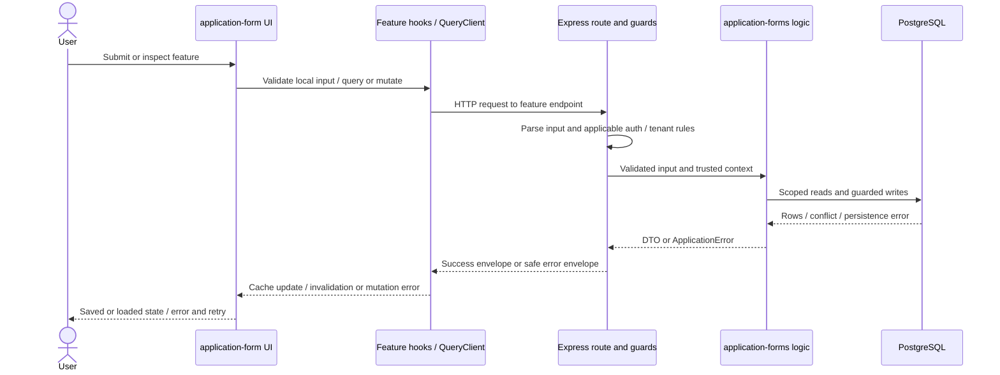
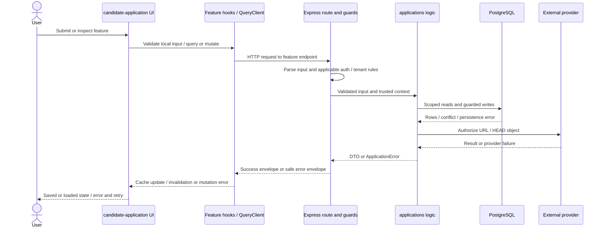
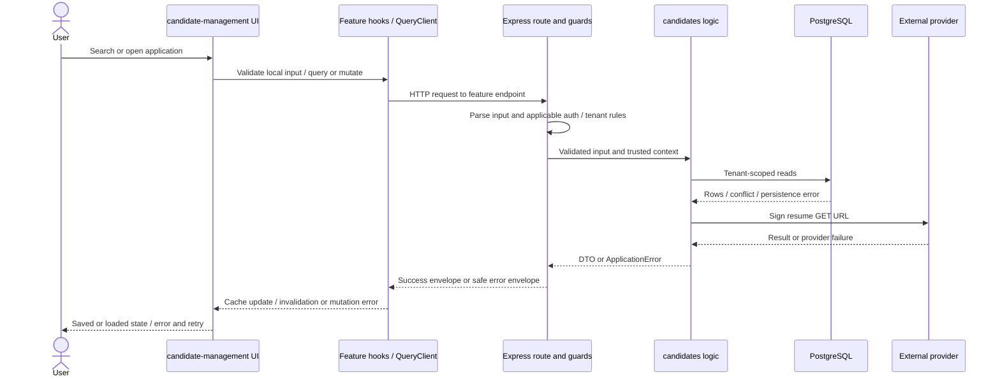
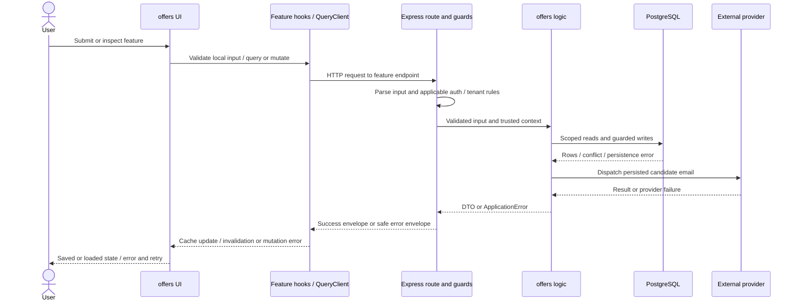
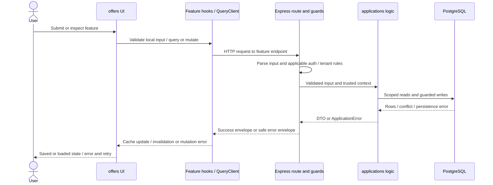
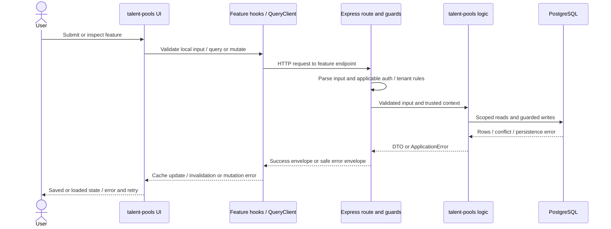
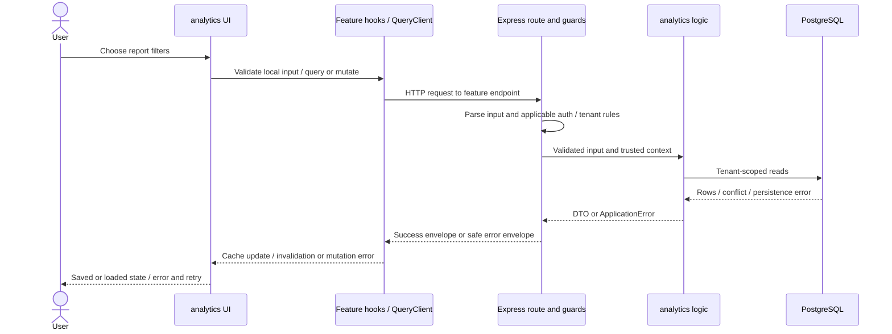

# 10 - End-to-end feature and data flows

Analysis date: 2026-10-17. Static repository investigation; no application execution, dependency installation, migrations, services, or deployment. Source presence is not proof of runtime success.

## VERIFIED

The 19 capability groups in document 01 are traced below. Each sequence describes source control flow; it does not assert a successful runtime path. Endpoint-specific schemas and exact serializers are catalogued in document 07. Role predicates and known broken paths are carried into each trace.

## 1. Identity and account lifecycle

| Trace step | Implementation and evidence |
| --- | --- |
| 1. User entry point | Register, verify, password login, Google OIDC when configured, password reset/change, logout and revoke all sessions |
| 2. Frontend route | /login; /register; /verify-email; /forgot-password; /reset-password -> [hiringloop-frontend/src/app/router/routes.tsx:1](../../hiringloop-frontend/src/app/router/routes.tsx#L1) |
| 3. Components | [hiringloop-frontend/src/features/auth/pages/VerifyEmailPage.tsx:1](../../hiringloop-frontend/src/features/auth/pages/VerifyEmailPage.tsx#L1); [hiringloop-frontend/src/features/auth/pages/ResetPasswordPage.tsx:1](../../hiringloop-frontend/src/features/auth/pages/ResetPasswordPage.tsx#L1); [hiringloop-frontend/src/features/auth/pages/RegisterPage.tsx:1](../../hiringloop-frontend/src/features/auth/pages/RegisterPage.tsx#L1); [hiringloop-frontend/src/features/auth/pages/LoginPage.tsx:1](../../hiringloop-frontend/src/features/auth/pages/LoginPage.tsx#L1); [hiringloop-frontend/src/features/auth/pages/ForgotPasswordPage.tsx:1](../../hiringloop-frontend/src/features/auth/pages/ForgotPasswordPage.tsx#L1); [hiringloop-frontend/src/features/auth/components/ResendVerificationForm.tsx:1](../../hiringloop-frontend/src/features/auth/components/ResendVerificationForm.tsx#L1); [hiringloop-frontend/src/features/auth/components/PasswordField.tsx:1](../../hiringloop-frontend/src/features/auth/components/PasswordField.tsx#L1); [hiringloop-frontend/src/features/auth/components/GoogleButton.tsx:1](../../hiringloop-frontend/src/features/auth/components/GoogleButton.tsx#L1); [hiringloop-frontend/src/features/auth/components/BrandMark.tsx:1](../../hiringloop-frontend/src/features/auth/components/BrandMark.tsx#L1); [hiringloop-frontend/src/features/auth/components/AuthPageHeader.tsx:1](../../hiringloop-frontend/src/features/auth/components/AuthPageHeader.tsx#L1); [hiringloop-frontend/src/features/auth/components/AuthAlert.tsx:1](../../hiringloop-frontend/src/features/auth/components/AuthAlert.tsx#L1) |
| 4. State | [hiringloop-frontend/src/features/auth/hooks/query-keys.ts:1](../../hiringloop-frontend/src/features/auth/hooks/query-keys.ts#L1); [hiringloop-frontend/src/features/auth/hooks/queries.ts:1](../../hiringloop-frontend/src/features/auth/hooks/queries.ts#L1); [hiringloop-frontend/src/features/auth/hooks/mutations.ts:1](../../hiringloop-frontend/src/features/auth/hooks/mutations.ts#L1) |
| 5. API invocation | [hiringloop-frontend/src/features/auth/api/auth.api.ts:1](../../hiringloop-frontend/src/features/auth/api/auth.api.ts#L1) |
| 6. Backend routes | GET /api/v1/auth/google/start -> hiringloop-backend/src/modules/auth/routes/auth-routes.js:66; GET /api/v1/auth/google/callback -> hiringloop-backend/src/modules/auth/routes/auth-routes.js:71; POST /api/v1/auth/login -> hiringloop-backend/src/modules/auth/routes/auth-routes.js:78; POST /api/v1/auth/password/forgot -> hiringloop-backend/src/modules/auth/routes/auth-routes.js:86; POST /api/v1/auth/password/reset -> hiringloop-backend/src/modules/auth/routes/auth-routes.js:94; GET /api/v1/auth/me -> hiringloop-backend/src/modules/auth/routes/auth-routes.js:102; GET /api/v1/auth/csrf -> hiringloop-backend/src/modules/auth/routes/auth-routes.js:103; POST /api/v1/auth/logout -> hiringloop-backend/src/modules/auth/routes/auth-routes.js:105; POST /api/v1/auth/sessions/revoke-all -> hiringloop-backend/src/modules/auth/routes/auth-routes.js:113; POST /api/v1/auth/password/change -> hiringloop-backend/src/modules/auth/routes/auth-routes.js:121; POST /api/v1/auth/verification/resend -> hiringloop-backend/src/modules/auth/routes/auth-routes.js:131; POST /api/v1/auth/register -> hiringloop-backend/src/modules/auth/routes/auth-routes.js:137; POST /api/v1/auth/verify-email -> hiringloop-backend/src/modules/auth/routes/auth-routes.js:143 |
| 7. Authentication / authorization | Anonymous account entry and authenticated session operations; Google routes conditional |
| 8. Validation | [hiringloop-backend/src/modules/auth/schemas/auth-schemas.js:1](../../hiringloop-backend/src/modules/auth/schemas/auth-schemas.js#L1) |
| 9. Business rules | Register/verify: 24h single-use token and enumeration-safe success text. Login checks Argon2/dummy hash and issues session; reset changes password and revokes sessions; Google requires verified claims and refuses implicit linking. [hiringloop-backend/src/modules/auth/use-cases/verify-email.js:1](../../hiringloop-backend/src/modules/auth/use-cases/verify-email.js#L1); [hiringloop-backend/src/modules/auth/use-cases/reset-password.js:1](../../hiringloop-backend/src/modules/auth/use-cases/reset-password.js#L1); [hiringloop-backend/src/modules/auth/use-cases/resend-verification.js:1](../../hiringloop-backend/src/modules/auth/use-cases/resend-verification.js#L1); [hiringloop-backend/src/modules/auth/use-cases/register-user.js:1](../../hiringloop-backend/src/modules/auth/use-cases/register-user.js#L1); [hiringloop-backend/src/modules/auth/use-cases/logout-session.js:1](../../hiringloop-backend/src/modules/auth/use-cases/logout-session.js#L1); [hiringloop-backend/src/modules/auth/use-cases/login-with-google.js:1](../../hiringloop-backend/src/modules/auth/use-cases/login-with-google.js#L1); [hiringloop-backend/src/modules/auth/use-cases/login-user.js:1](../../hiringloop-backend/src/modules/auth/use-cases/login-user.js#L1); [hiringloop-backend/src/modules/auth/use-cases/forgot-password.js:1](../../hiringloop-backend/src/modules/auth/use-cases/forgot-password.js#L1); [hiringloop-backend/src/modules/auth/use-cases/create-hiringloop-session.js:1](../../hiringloop-backend/src/modules/auth/use-cases/create-hiringloop-session.js#L1); [hiringloop-backend/src/modules/auth/use-cases/change-password.js:1](../../hiringloop-backend/src/modules/auth/use-cases/change-password.js#L1) |
| 10. Database reads / writes | User, PasswordCredential, AuthSession, AuthToken, AuthProviderIdentity; [hiringloop-backend/src/modules/auth/repositories/auth-repository.js:1](../../hiringloop-backend/src/modules/auth/repositories/auth-repository.js#L1) |
| 11. Provider / background | Google OIDC and SendGrid verification/reset email |
| 12. Serialization | Inline module/controller serialization; see document 07 |
| 13. Frontend update | Queries own server state; mutations invalidate/update resource cache. [hiringloop-frontend/src/features/auth/hooks/mutations.ts:1](../../hiringloop-frontend/src/features/auth/hooks/mutations.ts#L1) |
| 14. Success / failure | Controller status/envelope and DTO below; query updates/invalidation or navigation render saved state. No additional flow-specific failure was proven in this trace; shared network/auth/validation/conflict failures remain. Errors propagate through shared ApiError/feedback; backend ApplicationError carries safe code/status. |
| 15. Automated tests | [hiringloop-backend/tests/modules/auth/resend-verification.test.js:1](../../hiringloop-backend/tests/modules/auth/resend-verification.test.js#L1); [hiringloop-backend/tests/modules/auth/password-recovery.test.js:1](../../hiringloop-backend/tests/modules/auth/password-recovery.test.js#L1); [hiringloop-backend/tests/modules/auth/logout.test.js:1](../../hiringloop-backend/tests/modules/auth/logout.test.js#L1); [hiringloop-backend/tests/modules/auth/login.test.js:1](../../hiringloop-backend/tests/modules/auth/login.test.js#L1); [hiringloop-backend/tests/modules/auth/google-oidc.test.js:1](../../hiringloop-backend/tests/modules/auth/google-oidc.test.js#L1); [hiringloop-backend/tests/modules/auth/email-delivery.test.js:1](../../hiringloop-backend/tests/modules/auth/email-delivery.test.js#L1); [hiringloop-backend/tests/modules/auth/cors-csrf.test.js:1](../../hiringloop-backend/tests/modules/auth/cors-csrf.test.js#L1); [hiringloop-backend/tests/modules/auth/authenticate-session.test.js:1](../../hiringloop-backend/tests/modules/auth/authenticate-session.test.js#L1); [hiringloop-backend/tests/modules/auth/auth-workflows.test.js:1](../../hiringloop-backend/tests/modules/auth/auth-workflows.test.js#L1); [hiringloop-backend/tests/modules/auth/auth-utilities.test.js:1](../../hiringloop-backend/tests/modules/auth/auth-utilities.test.js#L1); [hiringloop-backend/tests/modules/auth/app-cors.test.js:1](../../hiringloop-backend/tests/modules/auth/app-cors.test.js#L1); [hiringloop-frontend/src/features/auth/api/auth.api.test.ts:1](../../hiringloop-frontend/src/features/auth/api/auth.api.test.ts#L1); [hiringloop-frontend/src/features/auth/auth-pages.test.tsx:1](../../hiringloop-frontend/src/features/auth/auth-pages.test.tsx#L1); [hiringloop-frontend/src/features/auth/hooks/queries.test.tsx:1](../../hiringloop-frontend/src/features/auth/hooks/queries.test.tsx#L1); [hiringloop-frontend/src/features/auth/hooks/mutations.test.tsx:1](../../hiringloop-frontend/src/features/auth/hooks/mutations.test.tsx#L1) |

### Source sequence

## 2. Organization onboarding and switching

| Trace step | Implementation and evidence |
| --- | --- |
| 1. User entry point | Create organization and Admin membership atomically; list memberships; resolve selected workspace |
| 2. Frontend route | /app; /app/organizations/new; /app/organizations/:organizationId -> [hiringloop-frontend/src/app/router/routes.tsx:1](../../hiringloop-frontend/src/app/router/routes.tsx#L1) |
| 3. Components | [hiringloop-frontend/src/features/organizations/pages/OrganizationWorkspacePage.tsx:1](../../hiringloop-frontend/src/features/organizations/pages/OrganizationWorkspacePage.tsx#L1); [hiringloop-frontend/src/features/organizations/pages/OrganizationOnboardingPage.tsx:1](../../hiringloop-frontend/src/features/organizations/pages/OrganizationOnboardingPage.tsx#L1); [hiringloop-frontend/src/features/organizations/pages/OrganizationLandingPage.tsx:1](../../hiringloop-frontend/src/features/organizations/pages/OrganizationLandingPage.tsx#L1); [hiringloop-frontend/src/features/organizations/components/OrganizationSwitcher.tsx:1](../../hiringloop-frontend/src/features/organizations/components/OrganizationSwitcher.tsx#L1) |
| 4. State | [hiringloop-frontend/src/features/organizations/hooks/query-keys.ts:1](../../hiringloop-frontend/src/features/organizations/hooks/query-keys.ts#L1); [hiringloop-frontend/src/features/organizations/hooks/queries.ts:1](../../hiringloop-frontend/src/features/organizations/hooks/queries.ts#L1); [hiringloop-frontend/src/features/organizations/hooks/mutations.ts:1](../../hiringloop-frontend/src/features/organizations/hooks/mutations.ts#L1) |
| 5. API invocation | [hiringloop-frontend/src/features/organizations/api/organizations.api.ts:1](../../hiringloop-frontend/src/features/organizations/api/organizations.api.ts#L1) |
| 6. Backend routes | GET /api/v1/organizations -> hiringloop-backend/src/modules/organizations/routes/organization-routes.js:67; POST /api/v1/organizations -> hiringloop-backend/src/modules/organizations/routes/organization-routes.js:68; GET /api/v1/organizations/:organizationId -> hiringloop-backend/src/modules/organizations/routes/organization-routes.js:75 |
| 7. Authentication / authorization | Live session + tenant membership + route permission; resource-specific rules below |
| 8. Validation | [hiringloop-backend/src/modules/organizations/schemas/organization-schemas.js:1](../../hiringloop-backend/src/modules/organizations/schemas/organization-schemas.js#L1) |
| 9. Business rules | Organization input validation, immutable slug allocation and transactional Admin membership creation; list returns only memberships. [hiringloop-backend/src/modules/organizations/use-cases/resolve-tenant-context.js:1](../../hiringloop-backend/src/modules/organizations/use-cases/resolve-tenant-context.js#L1); [hiringloop-backend/src/modules/organizations/use-cases/get-organization-by-id.js:1](../../hiringloop-backend/src/modules/organizations/use-cases/get-organization-by-id.js#L1); [hiringloop-backend/src/modules/organizations/use-cases/create-organization-for-user.js:1](../../hiringloop-backend/src/modules/organizations/use-cases/create-organization-for-user.js#L1) |
| 10. Database reads / writes | Organization, OrganizationMembership, AuditEvent; [hiringloop-backend/src/modules/organizations/repositories/organization-repository.js:1](../../hiringloop-backend/src/modules/organizations/repositories/organization-repository.js#L1) |
| 11. Provider / background | No external call on the traced path |
| 12. Serialization | [hiringloop-backend/src/modules/organizations/domain/organization-dto.js:1](../../hiringloop-backend/src/modules/organizations/domain/organization-dto.js#L1) |
| 13. Frontend update | Queries own server state; mutations invalidate/update resource cache. [hiringloop-frontend/src/features/organizations/hooks/mutations.ts:1](../../hiringloop-frontend/src/features/organizations/hooks/mutations.ts#L1) |
| 14. Success / failure | Controller status/envelope and DTO below; query updates/invalidation or navigation render saved state. No additional flow-specific failure was proven in this trace; shared network/auth/validation/conflict failures remain. Errors propagate through shared ApiError/feedback; backend ApplicationError carries safe code/status. |
| 15. Automated tests | [hiringloop-backend/tests/modules/organizations/tenant-context.test.js:1](../../hiringloop-backend/tests/modules/organizations/tenant-context.test.js#L1); [hiringloop-backend/tests/modules/organizations/organization-workflows.test.js:1](../../hiringloop-backend/tests/modules/organizations/organization-workflows.test.js#L1); [hiringloop-frontend/src/features/organizations/organizations.test.tsx:1](../../hiringloop-frontend/src/features/organizations/organizations.test.tsx#L1) |

### Source sequence

## 3. Team invitations and membership

| Trace step | Implementation and evidence |
| --- | --- |
| 1. User entry point | Admin invites, rotates/revokes invitations, changes/removes roles; verified recipient accepts; preserve final Admin |
| 2. Frontend route | /app/organizations/:organizationId/team; /invitations/accept -> [hiringloop-frontend/src/app/router/routes.tsx:1](../../hiringloop-frontend/src/app/router/routes.tsx#L1) |
| 3. Components | [hiringloop-frontend/src/features/team/pages/TeamPage.tsx:1](../../hiringloop-frontend/src/features/team/pages/TeamPage.tsx#L1); [hiringloop-frontend/src/features/team/pages/InvitationAcceptancePage.tsx:1](../../hiringloop-frontend/src/features/team/pages/InvitationAcceptancePage.tsx#L1); [hiringloop-frontend/src/features/team/components/ConfirmDialog.tsx:1](../../hiringloop-frontend/src/features/team/components/ConfirmDialog.tsx#L1) |
| 4. State | [hiringloop-frontend/src/features/team/hooks/query-keys.ts:1](../../hiringloop-frontend/src/features/team/hooks/query-keys.ts#L1); [hiringloop-frontend/src/features/team/hooks/queries.ts:1](../../hiringloop-frontend/src/features/team/hooks/queries.ts#L1); [hiringloop-frontend/src/features/team/hooks/mutations.ts:1](../../hiringloop-frontend/src/features/team/hooks/mutations.ts#L1) |
| 5. API invocation | [hiringloop-frontend/src/features/team/api/team.api.ts:1](../../hiringloop-frontend/src/features/team/api/team.api.ts#L1) |
| 6. Backend routes | POST /api/v1/organizations/:organizationId/invitations -> hiringloop-backend/src/modules/invitations/routes/invitation-routes.js:29; GET /api/v1/organizations/:organizationId/invitations -> hiringloop-backend/src/modules/invitations/routes/invitation-routes.js:41; DELETE /api/v1/organizations/:organizationId/invitations/:invitationId -> hiringloop-backend/src/modules/invitations/routes/invitation-routes.js:49; POST /api/v1/invitations/accept -> hiringloop-backend/src/modules/invitations/routes/invitation-routes.js:70; GET /api/v1/organizations/:organizationId/members -> hiringloop-backend/src/modules/members/routes/member-routes.js:28; PATCH /api/v1/organizations/:organizationId/members/:membershipId/role -> hiringloop-backend/src/modules/members/routes/member-routes.js:36; DELETE /api/v1/organizations/:organizationId/members/:membershipId -> hiringloop-backend/src/modules/members/routes/member-routes.js:48 |
| 7. Authentication / authorization | Live session + tenant membership + route permission; resource-specific rules below |
| 8. Validation | [hiringloop-backend/src/modules/invitations/schemas/invitation-schemas.js:1](../../hiringloop-backend/src/modules/invitations/schemas/invitation-schemas.js#L1) |
| 9. Business rules | Admin permissions for invitations/members; invitation recipient must be signed in with verified matching email; lock organization before final-Admin changes. [hiringloop-backend/src/modules/invitations/use-cases/revoke-invitation.js:1](../../hiringloop-backend/src/modules/invitations/use-cases/revoke-invitation.js#L1); [hiringloop-backend/src/modules/invitations/use-cases/create-invitation.js:1](../../hiringloop-backend/src/modules/invitations/use-cases/create-invitation.js#L1); [hiringloop-backend/src/modules/invitations/use-cases/accept-invitation.js:1](../../hiringloop-backend/src/modules/invitations/use-cases/accept-invitation.js#L1); [hiringloop-backend/src/modules/invitations/use-cases/list-invitations.js:1](../../hiringloop-backend/src/modules/invitations/use-cases/list-invitations.js#L1) |
| 10. Database reads / writes | Invitation, OrganizationMembership, AuditEvent; [hiringloop-backend/src/modules/invitations/repositories/invitation-repository.js:1](../../hiringloop-backend/src/modules/invitations/repositories/invitation-repository.js#L1) |
| 11. Provider / background | SendGrid invitation email |
| 12. Serialization | [hiringloop-backend/src/modules/invitations/domain/invitation-dto.js:1](../../hiringloop-backend/src/modules/invitations/domain/invitation-dto.js#L1) |
| 13. Frontend update | Queries own server state; mutations invalidate/update resource cache. [hiringloop-frontend/src/features/team/hooks/mutations.ts:1](../../hiringloop-frontend/src/features/team/hooks/mutations.ts#L1) |
| 14. Success / failure | Controller status/envelope and DTO below; query updates/invalidation or navigation render saved state. No additional flow-specific failure was proven in this trace; shared network/auth/validation/conflict failures remain. Errors propagate through shared ApiError/feedback; backend ApplicationError carries safe code/status. |
| 15. Automated tests | [hiringloop-frontend/src/features/team/team.test.tsx:1](../../hiringloop-frontend/src/features/team/team.test.tsx#L1); [hiringloop-frontend/src/features/team/pages/TeamPage.test.tsx:1](../../hiringloop-frontend/src/features/team/pages/TeamPage.test.tsx#L1); [hiringloop-frontend/src/features/team/pages/InvitationAcceptancePage.test.tsx:1](../../hiringloop-frontend/src/features/team/pages/InvitationAcceptancePage.test.tsx#L1); [hiringloop-frontend/src/features/team/hooks/mutations.test.tsx:1](../../hiringloop-frontend/src/features/team/hooks/mutations.test.tsx#L1); [hiringloop-frontend/src/features/team/components/ConfirmDialog.test.tsx:1](../../hiringloop-frontend/src/features/team/components/ConfirmDialog.test.tsx#L1); [hiringloop-frontend/src/features/team/api/team.api.test.ts:1](../../hiringloop-frontend/src/features/team/api/team.api.test.ts#L1); [hiringloop-backend/tests/modules/invitations/invitation-workflows.test.js:1](../../hiringloop-backend/tests/modules/invitations/invitation-workflows.test.js#L1); [hiringloop-backend/tests/modules/invitations/accept-invitation.test.js:1](../../hiringloop-backend/tests/modules/invitations/accept-invitation.test.js#L1) |

### Source sequence

## 4. Job lifecycle

| Trace step | Implementation and evidence |
| --- | --- |
| 1. User entry point | Draft creation, editing, open/close/reopen/archive with expectedVersion and readiness checks |
| 2. Frontend route | /app/organizations/:organizationId/jobs; /new; /:jobId; /:jobId/edit -> [hiringloop-frontend/src/app/router/routes.tsx:1](../../hiringloop-frontend/src/app/router/routes.tsx#L1) |
| 3. Components | [hiringloop-frontend/src/features/jobs/pages/JobsPage.tsx:1](../../hiringloop-frontend/src/features/jobs/pages/JobsPage.tsx#L1); [hiringloop-frontend/src/features/jobs/pages/JobDetailPage.tsx:1](../../hiringloop-frontend/src/features/jobs/pages/JobDetailPage.tsx#L1); [hiringloop-frontend/src/features/jobs/pages/EditJobPage.tsx:1](../../hiringloop-frontend/src/features/jobs/pages/EditJobPage.tsx#L1); [hiringloop-frontend/src/features/jobs/pages/CreateJobPage.tsx:1](../../hiringloop-frontend/src/features/jobs/pages/CreateJobPage.tsx#L1); [hiringloop-frontend/src/features/jobs/components/JobStatusBadge.tsx:1](../../hiringloop-frontend/src/features/jobs/components/JobStatusBadge.tsx#L1); [hiringloop-frontend/src/features/jobs/components/JobsNavigationLink.tsx:1](../../hiringloop-frontend/src/features/jobs/components/JobsNavigationLink.tsx#L1); [hiringloop-frontend/src/features/jobs/components/JobForm.tsx:1](../../hiringloop-frontend/src/features/jobs/components/JobForm.tsx#L1); [hiringloop-frontend/src/features/jobs/components/JobActions.tsx:1](../../hiringloop-frontend/src/features/jobs/components/JobActions.tsx#L1) |
| 4. State | [hiringloop-frontend/src/features/jobs/hooks/query-keys.ts:1](../../hiringloop-frontend/src/features/jobs/hooks/query-keys.ts#L1); [hiringloop-frontend/src/features/jobs/hooks/queries.ts:1](../../hiringloop-frontend/src/features/jobs/hooks/queries.ts#L1); [hiringloop-frontend/src/features/jobs/hooks/mutations.ts:1](../../hiringloop-frontend/src/features/jobs/hooks/mutations.ts#L1) |
| 5. API invocation | [hiringloop-frontend/src/features/jobs/api/jobs.api.ts:1](../../hiringloop-frontend/src/features/jobs/api/jobs.api.ts#L1) |
| 6. Backend routes | POST /api/v1/organizations/:organizationId/jobs -> hiringloop-backend/src/modules/jobs/routes/job-routes.js:43; GET /api/v1/organizations/:organizationId/jobs -> hiringloop-backend/src/modules/jobs/routes/job-routes.js:52; GET /api/v1/organizations/:organizationId/jobs/:jobId -> hiringloop-backend/src/modules/jobs/routes/job-routes.js:61; PATCH /api/v1/organizations/:organizationId/jobs/:jobId -> hiringloop-backend/src/modules/jobs/routes/job-routes.js:67; POST /api/v1/organizations/:organizationId/jobs/:jobId/open -> hiringloop-backend/src/modules/jobs/routes/job-routes.js:79; POST /api/v1/organizations/:organizationId/jobs/:jobId/close -> hiringloop-backend/src/modules/jobs/routes/job-routes.js:79; POST /api/v1/organizations/:organizationId/jobs/:jobId/reopen -> hiringloop-backend/src/modules/jobs/routes/job-routes.js:79; POST /api/v1/organizations/:organizationId/jobs/:jobId/archive -> hiringloop-backend/src/modules/jobs/routes/job-routes.js:79 |
| 7. Authentication / authorization | Live session + tenant membership + route permission; resource-specific rules below |
| 8. Validation | [hiringloop-backend/src/modules/jobs/schemas/job-schemas.js:1](../../hiringloop-backend/src/modules/jobs/schemas/job-schemas.js#L1) |
| 9. Business rules | Create DRAFT with pipeline/published form, validate readiness to OPEN, enforce lifecycle transitions and expectedVersion. [hiringloop-backend/src/modules/jobs/use-cases/job-use-cases.js:1](../../hiringloop-backend/src/modules/jobs/use-cases/job-use-cases.js#L1) |
| 10. Database reads / writes | Job, Pipeline, PipelineStage, ApplicationForm, ApplicationFormVersion, AuditEvent; [hiringloop-backend/src/modules/jobs/repositories/job-repository.js:1](../../hiringloop-backend/src/modules/jobs/repositories/job-repository.js#L1) |
| 11. Provider / background | No external call on the traced path |
| 12. Serialization | [hiringloop-backend/src/modules/jobs/domain/job-dto.js:1](../../hiringloop-backend/src/modules/jobs/domain/job-dto.js#L1) |
| 13. Frontend update | Queries own server state; mutations invalidate/update resource cache. [hiringloop-frontend/src/features/jobs/hooks/mutations.ts:1](../../hiringloop-frontend/src/features/jobs/hooks/mutations.ts#L1) |
| 14. Success / failure | Controller status/envelope and DTO below; query updates/invalidation or navigation render saved state. No additional flow-specific failure was proven in this trace; shared network/auth/validation/conflict failures remain. Errors propagate through shared ApiError/feedback; backend ApplicationError carries safe code/status. |
| 15. Automated tests | [hiringloop-frontend/src/features/jobs/pages/JobDetailPage.test.tsx:1](../../hiringloop-frontend/src/features/jobs/pages/JobDetailPage.test.tsx#L1); [hiringloop-frontend/src/features/jobs/pages/CreateJobPage.test.tsx:1](../../hiringloop-frontend/src/features/jobs/pages/CreateJobPage.test.tsx#L1); [hiringloop-frontend/src/features/jobs/jobs.test.ts:1](../../hiringloop-frontend/src/features/jobs/jobs.test.ts#L1); [hiringloop-frontend/src/features/jobs/job-permissions.test.tsx:1](../../hiringloop-frontend/src/features/jobs/job-permissions.test.tsx#L1); [hiringloop-backend/tests/modules/jobs/job-workflows.test.js:1](../../hiringloop-backend/tests/modules/jobs/job-workflows.test.js#L1) |

### Source sequence

## 5. Pipeline configuration

| Trace step | Implementation and evidence |
| --- | --- |
| 1. User entry point | Create/rename/reorder/delete stages; preserve entry at position 1; max 20 stages; version conflicts |
| 2. Frontend route | /app/organizations/:organizationId/jobs/:jobId/pipeline -> [hiringloop-frontend/src/app/router/routes.tsx:1](../../hiringloop-frontend/src/app/router/routes.tsx#L1) |
| 3. Components | [hiringloop-frontend/src/features/pipelines/pages/PipelineConfigurationPage.tsx:1](../../hiringloop-frontend/src/features/pipelines/pages/PipelineConfigurationPage.tsx#L1) |
| 4. State | [hiringloop-frontend/src/features/pipelines/hooks/query-keys.ts:1](../../hiringloop-frontend/src/features/pipelines/hooks/query-keys.ts#L1); [hiringloop-frontend/src/features/pipelines/hooks/queries.ts:1](../../hiringloop-frontend/src/features/pipelines/hooks/queries.ts#L1); [hiringloop-frontend/src/features/pipelines/hooks/mutations.ts:1](../../hiringloop-frontend/src/features/pipelines/hooks/mutations.ts#L1) |
| 5. API invocation | [hiringloop-frontend/src/features/pipelines/api/pipelines.api.ts:1](../../hiringloop-frontend/src/features/pipelines/api/pipelines.api.ts#L1) |
| 6. Backend routes | GET /api/v1/organizations/:organizationId/jobs/:jobId/pipeline -> hiringloop-backend/src/modules/pipelines/routes/pipeline-routes.js:29; POST /api/v1/organizations/:organizationId/jobs/:jobId/pipeline/stages -> hiringloop-backend/src/modules/pipelines/routes/pipeline-routes.js:35; PATCH /api/v1/organizations/:organizationId/jobs/:jobId/pipeline/stages/:stageId -> hiringloop-backend/src/modules/pipelines/routes/pipeline-routes.js:44; PUT /api/v1/organizations/:organizationId/jobs/:jobId/pipeline/stages/order -> hiringloop-backend/src/modules/pipelines/routes/pipeline-routes.js:53; DELETE /api/v1/organizations/:organizationId/jobs/:jobId/pipeline/stages/:stageId -> hiringloop-backend/src/modules/pipelines/routes/pipeline-routes.js:62 |
| 7. Authentication / authorization | Live session + tenant membership + route permission; resource-specific rules below |
| 8. Validation | [hiringloop-backend/src/modules/pipelines/schemas/pipeline-schemas.js:1](../../hiringloop-backend/src/modules/pipelines/schemas/pipeline-schemas.js#L1) |
| 9. Business rules | ENTRY cannot move/delete; unique normalized names, max 20; expectedVersion and DRAFT/OPEN lifecycle checks. [hiringloop-backend/src/modules/pipelines/use-cases/pipeline-use-cases.js:1](../../hiringloop-backend/src/modules/pipelines/use-cases/pipeline-use-cases.js#L1) |
| 10. Database reads / writes | Pipeline, PipelineStage, AuditEvent; [hiringloop-backend/src/modules/pipelines/repositories/pipeline-repository.js:1](../../hiringloop-backend/src/modules/pipelines/repositories/pipeline-repository.js#L1) |
| 11. Provider / background | No external call on the traced path |
| 12. Serialization | [hiringloop-backend/src/modules/pipelines/domain/pipeline-dto.js:1](../../hiringloop-backend/src/modules/pipelines/domain/pipeline-dto.js#L1) |
| 13. Frontend update | Queries own server state; mutations invalidate/update resource cache. [hiringloop-frontend/src/features/pipelines/hooks/mutations.ts:1](../../hiringloop-frontend/src/features/pipelines/hooks/mutations.ts#L1) |
| 14. Success / failure | Controller status/envelope and DTO below; query updates/invalidation or navigation render saved state. No additional flow-specific failure was proven in this trace; shared network/auth/validation/conflict failures remain. Errors propagate through shared ApiError/feedback; backend ApplicationError carries safe code/status. |
| 15. Automated tests | [hiringloop-backend/tests/modules/pipelines/pipeline-workflows.test.js:1](../../hiringloop-backend/tests/modules/pipelines/pipeline-workflows.test.js#L1); [hiringloop-frontend/src/features/pipelines/utils/pipeline-utils.test.ts:1](../../hiringloop-frontend/src/features/pipelines/utils/pipeline-utils.test.ts#L1); [hiringloop-frontend/src/features/pipelines/pages/PipelineConfigurationPage.test.tsx:1](../../hiringloop-frontend/src/features/pipelines/pages/PipelineConfigurationPage.test.tsx#L1); [hiringloop-frontend/src/features/pipelines/hooks/mutations.test.tsx:1](../../hiringloop-frontend/src/features/pipelines/hooks/mutations.test.tsx#L1); [hiringloop-frontend/src/features/pipelines/api/pipelines.api.test.ts:1](../../hiringloop-frontend/src/features/pipelines/api/pipelines.api.test.ts#L1) |

### Source sequence

## 6. Application form publishing

| Trace step | Implementation and evidence |
| --- | --- |
| 1. User entry point | Draft questions and options, eight question types, reorder, publish immutable versions, discard |
| 2. Frontend route | /app/organizations/:organizationId/jobs/:jobId/application-form -> [hiringloop-frontend/src/app/router/routes.tsx:1](../../hiringloop-frontend/src/app/router/routes.tsx#L1) |
| 3. Components | [hiringloop-frontend/src/features/application-form/pages/ApplicationFormBuilderPage.tsx:1](../../hiringloop-frontend/src/features/application-form/pages/ApplicationFormBuilderPage.tsx#L1) |
| 4. State | [hiringloop-frontend/src/features/application-form/hooks/query-keys.ts:1](../../hiringloop-frontend/src/features/application-form/hooks/query-keys.ts#L1); [hiringloop-frontend/src/features/application-form/hooks/queries.ts:1](../../hiringloop-frontend/src/features/application-form/hooks/queries.ts#L1); [hiringloop-frontend/src/features/application-form/hooks/mutations.ts:1](../../hiringloop-frontend/src/features/application-form/hooks/mutations.ts#L1) |
| 5. API invocation | [hiringloop-frontend/src/features/application-form/api/application-form.api.ts:1](../../hiringloop-frontend/src/features/application-form/api/application-form.api.ts#L1) |
| 6. Backend routes | GET /api/v1/organizations/:organizationId/jobs/:jobId/application-form -> hiringloop-backend/src/modules/application-forms/routes/application-form-routes.js:29; POST /api/v1/organizations/:organizationId/jobs/:jobId/application-form/draft -> hiringloop-backend/src/modules/application-forms/routes/application-form-routes.js:35; POST /api/v1/organizations/:organizationId/jobs/:jobId/application-form/draft/questions -> hiringloop-backend/src/modules/application-forms/routes/application-form-routes.js:41; PATCH /api/v1/organizations/:organizationId/jobs/:jobId/application-form/draft/questions/:questionId -> hiringloop-backend/src/modules/application-forms/routes/application-form-routes.js:50; DELETE /api/v1/organizations/:organizationId/jobs/:jobId/application-form/draft/questions/:questionId -> hiringloop-backend/src/modules/application-forms/routes/application-form-routes.js:59; PUT /api/v1/organizations/:organizationId/jobs/:jobId/application-form/draft/questions/order -> hiringloop-backend/src/modules/application-forms/routes/application-form-routes.js:65; POST /api/v1/organizations/:organizationId/jobs/:jobId/application-form/draft/publish -> hiringloop-backend/src/modules/application-forms/routes/application-form-routes.js:74; DELETE /api/v1/organizations/:organizationId/jobs/:jobId/application-form/draft -> hiringloop-backend/src/modules/application-forms/routes/application-form-routes.js:80 |
| 7. Authentication / authorization | Live session + tenant membership + route permission; resource-specific rules below |
| 8. Validation | [hiringloop-backend/src/modules/application-forms/schemas/application-form-schemas.js:1](../../hiringloop-backend/src/modules/application-forms/schemas/application-form-schemas.js#L1) |
| 9. Business rules | Draft revision required; max 100 questions; choice types/options validation; published versions immutable; active pointer changes transactionally. [hiringloop-backend/src/modules/application-forms/use-cases/application-form-use-cases.js:1](../../hiringloop-backend/src/modules/application-forms/use-cases/application-form-use-cases.js#L1) |
| 10. Database reads / writes | ApplicationForm, ApplicationFormVersion, ApplicationFormQuestion, ApplicationFormQuestionOption, AuditEvent; [hiringloop-backend/src/modules/application-forms/repositories/application-form-repository.js:1](../../hiringloop-backend/src/modules/application-forms/repositories/application-form-repository.js#L1) |
| 11. Provider / background | No external call on the traced path |
| 12. Serialization | [hiringloop-backend/src/modules/application-forms/domain/application-form-dto.js:1](../../hiringloop-backend/src/modules/application-forms/domain/application-form-dto.js#L1) |
| 13. Frontend update | Queries own server state; mutations invalidate/update resource cache. [hiringloop-frontend/src/features/application-form/hooks/mutations.ts:1](../../hiringloop-frontend/src/features/application-form/hooks/mutations.ts#L1) |
| 14. Success / failure | Controller status/envelope and DTO below; query updates/invalidation or navigation render saved state. No additional flow-specific failure was proven in this trace; shared network/auth/validation/conflict failures remain. Errors propagate through shared ApiError/feedback; backend ApplicationError carries safe code/status. |
| 15. Automated tests | [hiringloop-frontend/src/features/application-form/pages/ApplicationFormBuilderPage.test.tsx:1](../../hiringloop-frontend/src/features/application-form/pages/ApplicationFormBuilderPage.test.tsx#L1); [hiringloop-frontend/src/features/application-form/hooks/mutations.test.tsx:1](../../hiringloop-frontend/src/features/application-form/hooks/mutations.test.tsx#L1); [hiringloop-frontend/src/features/application-form/api/application-form.api.test.ts:1](../../hiringloop-frontend/src/features/application-form/api/application-form.api.test.ts#L1) |

### Source sequence

## 7. Public career browsing

| Trace step | Implementation and evidence |
| --- | --- |
| 1. User entry point | Paginated open jobs and tenant-scoped public detail with limited DTO |
| 2. Frontend route | /careers/:organizationSlug; /careers/:organizationSlug/jobs/:jobId -> [hiringloop-frontend/src/app/router/routes.tsx:1](../../hiringloop-frontend/src/app/router/routes.tsx#L1) |
| 3. Components | [hiringloop-frontend/src/features/public-careers/pages/PublicJobDetailPage.tsx:1](../../hiringloop-frontend/src/features/public-careers/pages/PublicJobDetailPage.tsx#L1); [hiringloop-frontend/src/features/public-careers/pages/PublicCareerPage.tsx:1](../../hiringloop-frontend/src/features/public-careers/pages/PublicCareerPage.tsx#L1) |
| 4. State | [hiringloop-frontend/src/features/public-careers/hooks/query-keys.ts:1](../../hiringloop-frontend/src/features/public-careers/hooks/query-keys.ts#L1); [hiringloop-frontend/src/features/public-careers/hooks/queries.ts:1](../../hiringloop-frontend/src/features/public-careers/hooks/queries.ts#L1) |
| 5. API invocation | [hiringloop-frontend/src/features/public-careers/api/public-careers.api.ts:1](../../hiringloop-frontend/src/features/public-careers/api/public-careers.api.ts#L1); [hiringloop-frontend/src/features/public-careers/api/public-application.api.ts:1](../../hiringloop-frontend/src/features/public-careers/api/public-application.api.ts#L1) |
| 6. Backend routes | GET /api/v1/public/careers/:organizationSlug/jobs -> hiringloop-backend/src/modules/public-careers/routes/public-career-routes.js:30; GET /api/v1/public/careers/:organizationSlug/jobs/:jobId -> hiringloop-backend/src/modules/public-careers/routes/public-career-routes.js:39; POST /api/v1/public/careers/:organizationSlug/jobs/:jobId/applications -> hiringloop-backend/src/modules/public-careers/routes/public-career-routes.js:61 |
| 7. Authentication / authorization | Anonymous public path; public rate limiter and global production Origin validation |
| 8. Validation | [hiringloop-backend/src/modules/public-careers/schemas/public-career-schemas.js:1](../../hiringloop-backend/src/modules/public-careers/schemas/public-career-schemas.js#L1) |
| 9. Business rules | Resolve organization slug, then organization-scoped OPEN job list/detail only; bounded page size. [hiringloop-backend/src/modules/public-careers/use-cases/public-career-use-cases.js:1](../../hiringloop-backend/src/modules/public-careers/use-cases/public-career-use-cases.js#L1) |
| 10. Database reads / writes | Organization, Job;  |
| 11. Provider / background | No external call on the traced path |
| 12. Serialization | [hiringloop-backend/src/modules/public-careers/domain/public-career-dto.js:1](../../hiringloop-backend/src/modules/public-careers/domain/public-career-dto.js#L1) |
| 13. Frontend update | Queries own server state; mutations invalidate/update resource cache.  |
| 14. Success / failure | Controller status/envelope and DTO below; query updates/invalidation or navigation render saved state. No additional flow-specific failure was proven in this trace; shared network/auth/validation/conflict failures remain. Errors propagate through shared ApiError/feedback; backend ApplicationError carries safe code/status. |
| 15. Automated tests | [hiringloop-backend/tests/modules/public-careers/public-career-use-cases.test.js:1](../../hiringloop-backend/tests/modules/public-careers/public-career-use-cases.test.js#L1); [hiringloop-backend/tests/modules/public-careers/public-career-http.test.js:1](../../hiringloop-backend/tests/modules/public-careers/public-career-http.test.js#L1); [hiringloop-frontend/src/features/public-careers/public-careers.test.tsx:1](../../hiringloop-frontend/src/features/public-careers/public-careers.test.tsx#L1); [hiringloop-frontend/src/features/public-careers/hooks/query-keys.test.ts:1](../../hiringloop-frontend/src/features/public-careers/hooks/query-keys.test.ts#L1); [hiringloop-frontend/src/features/public-careers/api/public-application.api.test.ts:1](../../hiringloop-frontend/src/features/public-careers/api/public-application.api.test.ts#L1) |

### Source sequence

## 8. Public candidate applications

| Trace step | Implementation and evidence |
| --- | --- |
| 1. User entry point | Dynamic form, S3 direct upload with signed `If-None-Match: *`, HEAD and short byte-signature validation, atomic candidate/application/answer/document/history creation and idempotency |
| 2. Frontend route | /careers/:organizationSlug/jobs/:jobId/apply -> [hiringloop-frontend/src/app/router/routes.tsx:1](../../hiringloop-frontend/src/app/router/routes.tsx#L1) |
| 3. Components | [hiringloop-frontend/src/features/candidate-application/pages/PublicApplyPage.tsx:1](../../hiringloop-frontend/src/features/candidate-application/pages/PublicApplyPage.tsx#L1); [hiringloop-frontend/src/features/candidate-application/components/ApplicationQuestionField.tsx:1](../../hiringloop-frontend/src/features/candidate-application/components/ApplicationQuestionField.tsx#L1) |
| 4. State | [hiringloop-frontend/src/features/candidate-application/hooks/queries.ts:1](../../hiringloop-frontend/src/features/candidate-application/hooks/queries.ts#L1); [hiringloop-frontend/src/features/candidate-application/hooks/mutations.ts:1](../../hiringloop-frontend/src/features/candidate-application/hooks/mutations.ts#L1) |
| 5. API invocation | [hiringloop-frontend/src/features/public-careers/api/public-careers.api.ts:1](../../hiringloop-frontend/src/features/public-careers/api/public-careers.api.ts#L1); [hiringloop-frontend/src/features/public-careers/api/public-application.api.ts:1](../../hiringloop-frontend/src/features/public-careers/api/public-application.api.ts#L1) |
| 6. Backend routes | GET /api/v1/public/careers/:organizationSlug/jobs/:jobId/application-form -> hiringloop-backend/src/modules/public-careers/routes/public-career-routes.js:46; POST /api/v1/public/careers/:organizationSlug/jobs/:jobId/application-uploads -> hiringloop-backend/src/modules/public-careers/routes/public-career-routes.js:52; POST /api/v1/public/careers/:organizationSlug/jobs/:jobId/applications -> hiringloop-backend/src/modules/public-careers/routes/public-career-routes.js:61 |
| 7. Authentication / authorization | Anonymous public path; public rate limiter and global production Origin validation |
| 8. Validation | [hiringloop-backend/src/modules/applications/schemas/public-application-schemas.js:1](../../hiringloop-backend/src/modules/applications/schemas/public-application-schemas.js#L1); [hiringloop-backend/src/modules/applications/schemas/outcome-schemas.js:1](../../hiringloop-backend/src/modules/applications/schemas/outcome-schemas.js#L1) |
| 9. Business rules | Validate published form/answers, pending unexpired upload metadata, size, MIME and shallow format signature, entry stage and OPEN job. Scope upload lookup to organization/job; scope idempotency to org/job/key/fingerprint; unique candidate/job submission. [hiringloop-backend/src/modules/applications/use-cases/public-application-use-cases.js:1](../../hiringloop-backend/src/modules/applications/use-cases/public-application-use-cases.js#L1) |
| 10. Database reads / writes | Candidate, Application, ApplicationAnswer, CandidateDocument, ApplicationUpload, ApplicationStageHistory; [hiringloop-backend/src/modules/applications/repositories/application-repository.js:1](../../hiringloop-backend/src/modules/applications/repositories/application-repository.js#L1) |
| 11. Provider / background | S3 signed conditional PUT directly from browser (`If-None-Match: *` is signed and required); server HEAD plus a ranged prefix read before commit. Conditional write prevents replay overwrite of an existing current object. No real S3 configuration was verified. |
| 12. Serialization | [hiringloop-backend/src/modules/applications/domain/outcome-dto.js:1](../../hiringloop-backend/src/modules/applications/domain/outcome-dto.js#L1); [hiringloop-backend/src/modules/applications/domain/application-dto.js:1](../../hiringloop-backend/src/modules/applications/domain/application-dto.js#L1) |
| 13. Frontend update | Queries own server state; mutations invalidate/update resource cache. [hiringloop-frontend/src/features/candidate-application/hooks/mutations.ts:1](../../hiringloop-frontend/src/features/candidate-application/hooks/mutations.ts#L1) |
| 14. Success / failure | Confirmation DTO (submitted, submittedAt, job); upload IDs/keys omitted from confirmation. UI focuses success heading. S01 is resolved in Phase 3E; S02 remains for full parsing/malware scanning and storage-side size caps; S04 anonymous canonical identity update risk remains. Errors propagate through shared ApiError/feedback; backend ApplicationError carries safe code/status. |
| 15. Automated tests | [hiringloop-backend/tests/integration/phase17-tenant-isolation-http.test.js:1](../../hiringloop-backend/tests/integration/phase17-tenant-isolation-http.test.js#L1); [hiringloop-backend/tests/integration/phase17-talent-pools-http.test.js:1](../../hiringloop-backend/tests/integration/phase17-talent-pools-http.test.js#L1); [hiringloop-backend/tests/integration/phase17-outcomes-http.test.js:1](../../hiringloop-backend/tests/integration/phase17-outcomes-http.test.js#L1); [hiringloop-backend/tests/integration/phase17-offers-http.test.js:1](../../hiringloop-backend/tests/integration/phase17-offers-http.test.js#L1); [hiringloop-backend/tests/integration/phase17-access-http.test.js:1](../../hiringloop-backend/tests/integration/phase17-access-http.test.js#L1); [hiringloop-backend/tests/integration/database/phase17-offer-talent-integrity.test.js:1](../../hiringloop-backend/tests/integration/database/phase17-offer-talent-integrity.test.js#L1); [hiringloop-backend/tests/modules/applications/public-application-use-cases.test.js:1](../../hiringloop-backend/tests/modules/applications/public-application-use-cases.test.js#L1); [hiringloop-backend/tests/modules/applications/public-application-http.test.js:1](../../hiringloop-backend/tests/modules/applications/public-application-http.test.js#L1); [hiringloop-backend/tests/modules/phase17-offer-outcome-use-cases.test.js:1](../../hiringloop-backend/tests/modules/phase17-offer-outcome-use-cases.test.js#L1); [hiringloop-frontend/src/features/candidate-application/utils/direct-upload.test.ts:1](../../hiringloop-frontend/src/features/candidate-application/utils/direct-upload.test.ts#L1); [hiringloop-frontend/src/features/candidate-application/utils/application-utils.test.ts:1](../../hiringloop-frontend/src/features/candidate-application/utils/application-utils.test.ts#L1); [hiringloop-frontend/src/features/candidate-application/pages/PublicApplyPage.test.tsx:1](../../hiringloop-frontend/src/features/candidate-application/pages/PublicApplyPage.test.tsx#L1) |

### Source sequence

Upload subflow precedes submission: UI requests reservation -> API saves ApplicationUpload/signs PUT -> UI uploads bytes directly to S3 with credentials omit -> UI POSTs application with uploadId and Idempotency-Key -> server HEADs object -> atomic submission consumes reservation. [hiringloop-frontend/src/features/candidate-application/utils/direct-upload.ts:1](../../hiringloop-frontend/src/features/candidate-application/utils/direct-upload.ts#L1); [hiringloop-backend/src/modules/applications/use-cases/public-application-use-cases.js:323](../../hiringloop-backend/src/modules/applications/use-cases/public-application-use-cases.js#L323).

## 9. Candidate and application review

| Trace step | Implementation and evidence |
| --- | --- |
| 1. User entry point | Search/filter/sort/page candidates; submitted answers/history/outcomes; authorized signed resume access |
| 2. Frontend route | /app/organizations/:organizationId/candidates; /:candidateId; /applications/:applicationId -> [hiringloop-frontend/src/app/router/routes.tsx:1](../../hiringloop-frontend/src/app/router/routes.tsx#L1) |
| 3. Components | [hiringloop-frontend/src/features/candidate-management/pages/CandidatesPage.tsx:1](../../hiringloop-frontend/src/features/candidate-management/pages/CandidatesPage.tsx#L1); [hiringloop-frontend/src/features/candidate-management/pages/CandidateDetailPage.tsx:1](../../hiringloop-frontend/src/features/candidate-management/pages/CandidateDetailPage.tsx#L1); [hiringloop-frontend/src/features/candidate-management/pages/ApplicationDetailPage.tsx:1](../../hiringloop-frontend/src/features/candidate-management/pages/ApplicationDetailPage.tsx#L1); [hiringloop-frontend/src/features/candidate-management/components/CandidatesNavigationLink.tsx:1](../../hiringloop-frontend/src/features/candidate-management/components/CandidatesNavigationLink.tsx#L1) |
| 4. State | [hiringloop-frontend/src/features/candidate-management/hooks/query-keys.ts:1](../../hiringloop-frontend/src/features/candidate-management/hooks/query-keys.ts#L1); [hiringloop-frontend/src/features/candidate-management/hooks/queries.ts:1](../../hiringloop-frontend/src/features/candidate-management/hooks/queries.ts#L1); [hiringloop-frontend/src/features/candidate-management/hooks/mutations.ts:1](../../hiringloop-frontend/src/features/candidate-management/hooks/mutations.ts#L1) |
| 5. API invocation | [hiringloop-frontend/src/features/candidate-management/api/candidate-management.api.ts:1](../../hiringloop-frontend/src/features/candidate-management/api/candidate-management.api.ts#L1) |
| 6. Backend routes | GET /api/v1/organizations/:organizationId/candidates -> hiringloop-backend/src/modules/candidates/routes/candidate-management-routes.js:29; GET /api/v1/organizations/:organizationId/candidates/:candidateId -> hiringloop-backend/src/modules/candidates/routes/candidate-management-routes.js:38; GET /api/v1/organizations/:organizationId/applications/:applicationId -> hiringloop-backend/src/modules/candidates/routes/candidate-management-routes.js:44; POST /api/v1/organizations/:organizationId/candidate-documents/:documentId/access -> hiringloop-backend/src/modules/candidates/routes/candidate-management-routes.js:50 |
| 7. Authentication / authorization | Live session + tenant membership + route permission; resource-specific rules below |
| 8. Validation | [hiringloop-backend/src/modules/candidates/schemas/candidate-management-schemas.js:1](../../hiringloop-backend/src/modules/candidates/schemas/candidate-management-schemas.js#L1) |
| 9. Business rules | Admin/Recruiter only; scope every lookup to tenant. List search/filter/sort/page, detail projections and signed resume URL. [hiringloop-backend/src/modules/candidates/use-cases/candidate-management-use-cases.js:1](../../hiringloop-backend/src/modules/candidates/use-cases/candidate-management-use-cases.js#L1) |
| 10. Database reads / writes | Candidate, Application, ApplicationAnswer, CandidateDocument, ApplicationStageHistory, ApplicationOutcomeEvent; [hiringloop-backend/src/modules/candidates/repositories/candidate-management-repository.js:1](../../hiringloop-backend/src/modules/candidates/repositories/candidate-management-repository.js#L1) |
| 11. Provider / background | S3 signed GET, 300-second access URL |
| 12. Serialization | [hiringloop-backend/src/modules/candidates/domain/candidate-management-dto.js:1](../../hiringloop-backend/src/modules/candidates/domain/candidate-management-dto.js#L1) |
| 13. Frontend update | Queries own server state; mutations invalidate/update resource cache. [hiringloop-frontend/src/features/candidate-management/hooks/mutations.ts:1](../../hiringloop-frontend/src/features/candidate-management/hooks/mutations.ts#L1) |
| 14. Success / failure | Controller status/envelope and DTO below; query updates/invalidation or navigation render saved state. E09 empty-page total is incorrect. Errors propagate through shared ApiError/feedback; backend ApplicationError carries safe code/status. |
| 15. Automated tests | [hiringloop-backend/tests/modules/candidates/candidate-management-use-cases.test.js:1](../../hiringloop-backend/tests/modules/candidates/candidate-management-use-cases.test.js#L1); [hiringloop-backend/tests/modules/candidates/candidate-management-http.test.js:1](../../hiringloop-backend/tests/modules/candidates/candidate-management-http.test.js#L1); [hiringloop-frontend/src/features/candidate-management/candidate-management.test.tsx:1](../../hiringloop-frontend/src/features/candidate-management/candidate-management.test.tsx#L1); [hiringloop-frontend/src/features/candidate-management/api/candidate-management.api.test.ts:1](../../hiringloop-frontend/src/features/candidate-management/api/candidate-management.api.test.ts#L1) |

### Source sequence

## 10. Interview scheduling

| Trace step | Implementation and evidence |
| --- | --- |
| 1. User entry point | Schedule, list calendar/assigned, detail, update participants, reschedule, cancel and conflict checks |
| 2. Frontend route | /app/organizations/:organizationId/interviews; /:interviewId -> [hiringloop-frontend/src/app/router/routes.tsx:1](../../hiringloop-frontend/src/app/router/routes.tsx#L1) |
| 3. Components | [hiringloop-frontend/src/features/interviews/pages/InterviewsPage.tsx:1](../../hiringloop-frontend/src/features/interviews/pages/InterviewsPage.tsx#L1); [hiringloop-frontend/src/features/interviews/pages/InterviewDetailPage.tsx:1](../../hiringloop-frontend/src/features/interviews/pages/InterviewDetailPage.tsx#L1); [hiringloop-frontend/src/features/interviews/components/InterviewFormDialog.tsx:1](../../hiringloop-frontend/src/features/interviews/components/InterviewFormDialog.tsx#L1); [hiringloop-frontend/src/features/interviews/components/ApplicationInterviews.tsx:1](../../hiringloop-frontend/src/features/interviews/components/ApplicationInterviews.tsx#L1) |
| 4. State | [hiringloop-frontend/src/features/interviews/hooks/query-keys.ts:1](../../hiringloop-frontend/src/features/interviews/hooks/query-keys.ts#L1); [hiringloop-frontend/src/features/interviews/hooks/queries.ts:1](../../hiringloop-frontend/src/features/interviews/hooks/queries.ts#L1); [hiringloop-frontend/src/features/interviews/hooks/mutations.ts:1](../../hiringloop-frontend/src/features/interviews/hooks/mutations.ts#L1) |
| 5. API invocation | [hiringloop-frontend/src/features/interviews/api/interviews.api.ts:1](../../hiringloop-frontend/src/features/interviews/api/interviews.api.ts#L1) |
| 6. Backend routes | POST /api/v1/organizations/:organizationId/applications/:applicationId/interviews -> hiringloop-backend/src/modules/interviews/routes/interview-routes.js:45; GET /api/v1/organizations/:organizationId/applications/:applicationId/interviews -> hiringloop-backend/src/modules/interviews/routes/interview-routes.js:54; GET /api/v1/organizations/:organizationId/interviews -> hiringloop-backend/src/modules/interviews/routes/interview-routes.js:60; GET /api/v1/organizations/:organizationId/interviews/participants -> hiringloop-backend/src/modules/interviews/routes/interview-routes.js:38; GET /api/v1/organizations/:organizationId/interviews/:interviewId -> hiringloop-backend/src/modules/interviews/routes/interview-routes.js:69; PATCH /api/v1/organizations/:organizationId/interviews/:interviewId -> hiringloop-backend/src/modules/interviews/routes/interview-routes.js:75; POST /api/v1/organizations/:organizationId/interviews/:interviewId/reschedule -> hiringloop-backend/src/modules/interviews/routes/interview-routes.js:84; POST /api/v1/organizations/:organizationId/interviews/:interviewId/cancel -> hiringloop-backend/src/modules/interviews/routes/interview-routes.js:93 |
| 7. Authentication / authorization | Live session + tenant membership + route permission; resource-specific rules below |
| 8. Validation | [hiringloop-backend/src/modules/interviews/schemas/interview-schemas.js:1](../../hiringloop-backend/src/modules/interviews/schemas/interview-schemas.js#L1) |
| 9. Business rules | Admin/Recruiter manage and discover tenant participants through the interview-specific permission; membership management remains separate. All supported roles read subject to assignment rules. Future aware datetime, IANA zone, duration/participant validation, transactional membership recheck, participant-history protection and serialized overlap checks. [hiringloop-backend/src/modules/interviews/use-cases/interview-use-cases.js:1](../../hiringloop-backend/src/modules/interviews/use-cases/interview-use-cases.js#L1); [hiringloop-backend/src/modules/interviews/repositories/interview-repository.js:1](../../hiringloop-backend/src/modules/interviews/repositories/interview-repository.js#L1) |
| 10. Database reads / writes | Interview, InterviewParticipant, Application, OrganizationMembership, AuditEvent, Notification; [hiringloop-backend/src/modules/interviews/repositories/interview-repository.js:1](../../hiringloop-backend/src/modules/interviews/repositories/interview-repository.js#L1) |
| 11. Provider / background | Post-commit in-app notification service; not durable background work |
| 12. Serialization | [hiringloop-backend/src/modules/interviews/domain/interview-dto.js:1](../../hiringloop-backend/src/modules/interviews/domain/interview-dto.js#L1) |
| 13. Frontend update | Queries own server state; mutations invalidate/update resource cache. [hiringloop-frontend/src/features/interviews/hooks/mutations.ts:1](../../hiringloop-frontend/src/features/interviews/hooks/mutations.ts#L1) |
| 14. Success / failure | Controller status/envelope and DTO below; query updates/invalidation or navigation render saved state. Phase 3B resolved E01 participant replacement, E02 notification projection and E03 recruiter picker. Overlap checks now serialize on tenant/participant keys; database concurrency verification is recorded in document 20. Errors propagate through shared ApiError/feedback; backend ApplicationError carries safe code/status. |
| 15. Automated tests | [hiringloop-frontend/src/features/interviews/utils/interview-utils.test.ts:1](../../hiringloop-frontend/src/features/interviews/utils/interview-utils.test.ts#L1); [hiringloop-frontend/src/features/interviews/interviews.test.tsx:1](../../hiringloop-frontend/src/features/interviews/interviews.test.tsx#L1); [hiringloop-backend/tests/modules/interviews/interview-use-cases.test.js:1](../../hiringloop-backend/tests/modules/interviews/interview-use-cases.test.js#L1); [hiringloop-backend/tests/modules/interviews/interview-http.test.js:1](../../hiringloop-backend/tests/modules/interviews/interview-http.test.js#L1); [hiringloop-backend/tests/integration/database/interview-scheduling-foundation.test.js:1](../../hiringloop-backend/tests/integration/database/interview-scheduling-foundation.test.js#L1); [hiringloop-backend/tests/integration/database/phase18-interview-audit.test.js:1](../../hiringloop-backend/tests/integration/database/phase18-interview-audit.test.js#L1) |

### Source sequence

## 11. Scorecard templates and feedback

| Trace step | Implementation and evidence |
| --- | --- |
| 1. User entry point | Publish versioned rating/text templates; assigned participant saves/submits; restricted feedback review |
| 2. Frontend route | /app/organizations/:organizationId/jobs/:jobId/scorecard; /interviews/:interviewId/scorecard -> [hiringloop-frontend/src/app/router/routes.tsx:1](../../hiringloop-frontend/src/app/router/routes.tsx#L1) |
| 3. Components | [hiringloop-frontend/src/features/scorecards/pages/ScorecardTemplatePage.tsx:1](../../hiringloop-frontend/src/features/scorecards/pages/ScorecardTemplatePage.tsx#L1); [hiringloop-frontend/src/features/scorecards/pages/MyScorecardPage.tsx:1](../../hiringloop-frontend/src/features/scorecards/pages/MyScorecardPage.tsx#L1); [hiringloop-frontend/src/features/scorecards/components/ScorecardReadOnly.tsx:1](../../hiringloop-frontend/src/features/scorecards/components/ScorecardReadOnly.tsx#L1); [hiringloop-frontend/src/features/scorecards/components/ScorecardForm.tsx:1](../../hiringloop-frontend/src/features/scorecards/components/ScorecardForm.tsx#L1); [hiringloop-frontend/src/features/scorecards/components/FeedbackSections.tsx:1](../../hiringloop-frontend/src/features/scorecards/components/FeedbackSections.tsx#L1) |
| 4. State | [hiringloop-frontend/src/features/scorecards/hooks/query-keys.ts:1](../../hiringloop-frontend/src/features/scorecards/hooks/query-keys.ts#L1); [hiringloop-frontend/src/features/scorecards/hooks/queries.ts:1](../../hiringloop-frontend/src/features/scorecards/hooks/queries.ts#L1); [hiringloop-frontend/src/features/scorecards/hooks/mutations.ts:1](../../hiringloop-frontend/src/features/scorecards/hooks/mutations.ts#L1) |
| 5. API invocation | [hiringloop-frontend/src/features/scorecards/api/scorecards.api.ts:1](../../hiringloop-frontend/src/features/scorecards/api/scorecards.api.ts#L1) |
| 6. Backend routes | GET /api/v1/organizations/:organizationId/jobs/:jobId/scorecard-template -> hiringloop-backend/src/modules/scorecards/routes/scorecard-routes.js:33; POST /api/v1/organizations/:organizationId/jobs/:jobId/scorecard-template/draft -> hiringloop-backend/src/modules/scorecards/routes/scorecard-routes.js:39; PATCH /api/v1/organizations/:organizationId/jobs/:jobId/scorecard-template/draft -> hiringloop-backend/src/modules/scorecards/routes/scorecard-routes.js:45; POST /api/v1/organizations/:organizationId/jobs/:jobId/scorecard-template/publish -> hiringloop-backend/src/modules/scorecards/routes/scorecard-routes.js:51; GET /api/v1/organizations/:organizationId/interviews/:interviewId/scorecards -> hiringloop-backend/src/modules/scorecards/routes/scorecard-routes.js:57; GET /api/v1/organizations/:organizationId/interviews/:interviewId/my-scorecard -> hiringloop-backend/src/modules/scorecards/routes/scorecard-routes.js:63; PATCH /api/v1/organizations/:organizationId/interviews/:interviewId/my-scorecard -> hiringloop-backend/src/modules/scorecards/routes/scorecard-routes.js:69; POST /api/v1/organizations/:organizationId/interviews/:interviewId/my-scorecard/submit -> hiringloop-backend/src/modules/scorecards/routes/scorecard-routes.js:75; GET /api/v1/organizations/:organizationId/interviews/:interviewId/scorecards/:scorecardId -> hiringloop-backend/src/modules/scorecards/routes/scorecard-routes.js:81; GET /api/v1/organizations/:organizationId/applications/:applicationId/scorecards -> hiringloop-backend/src/modules/scorecards/routes/scorecard-routes.js:87 |
| 7. Authentication / authorization | Live session + tenant membership + route permission; resource-specific rules below |
| 8. Validation | [hiringloop-backend/src/modules/scorecards/schemas/scorecard-schemas.js:1](../../hiringloop-backend/src/modules/scorecards/schemas/scorecard-schemas.js#L1) |
| 9. Business rules | Only managers edit template; assignment required for own feedback; rating/text values must match published criterion; submitted feedback immutable; revision conflicts. [hiringloop-backend/src/modules/scorecards/use-cases/scorecard-use-cases.js:1](../../hiringloop-backend/src/modules/scorecards/use-cases/scorecard-use-cases.js#L1) |
| 10. Database reads / writes | ScorecardTemplate, ScorecardTemplateVersion, ScorecardCriterion, Scorecard, ScorecardResponse, AuditEvent, Notification; [hiringloop-backend/src/modules/scorecards/repositories/scorecard-repository.js:1](../../hiringloop-backend/src/modules/scorecards/repositories/scorecard-repository.js#L1) |
| 11. Provider / background | Post-commit in-app notification service; not durable background work |
| 12. Serialization | [hiringloop-backend/src/modules/scorecards/domain/scorecard-dto.js:1](../../hiringloop-backend/src/modules/scorecards/domain/scorecard-dto.js#L1) |
| 13. Frontend update | Queries own server state; mutations invalidate/update resource cache. [hiringloop-frontend/src/features/scorecards/hooks/mutations.ts:1](../../hiringloop-frontend/src/features/scorecards/hooks/mutations.ts#L1) |
| 14. Success / failure | Controller status/envelope and DTO below; query updates/invalidation or navigation render saved state. E06 was reproduced and repaired in Phase 3C: invalid/incomplete save outcomes abort before error translation, preserving draft fields/revision/responses. Stale revisions and submitted-card immutability remain conflict outcomes. Notifications are attempted post-commit; failures are logged without reverting a successful submission. |
| 15. Automated tests | [hiringloop-frontend/src/features/scorecards/pages/ScorecardTemplatePage.test.tsx:1](../../hiringloop-frontend/src/features/scorecards/pages/ScorecardTemplatePage.test.tsx#L1); [hiringloop-frontend/src/features/scorecards/pages/MyScorecardPage.test.tsx:1](../../hiringloop-frontend/src/features/scorecards/pages/MyScorecardPage.test.tsx#L1); [hiringloop-frontend/src/features/scorecards/components/ScorecardForm.test.tsx:1](../../hiringloop-frontend/src/features/scorecards/components/ScorecardForm.test.tsx#L1); [hiringloop-frontend/src/features/scorecards/components/FeedbackSections.test.tsx:1](../../hiringloop-frontend/src/features/scorecards/components/FeedbackSections.test.tsx#L1); [hiringloop-backend/tests/modules/scorecards/scorecard-schemas.test.js:1](../../hiringloop-backend/tests/modules/scorecards/scorecard-schemas.test.js#L1); [hiringloop-backend/tests/modules/scorecards/scorecard-http.test.js:1](../../hiringloop-backend/tests/modules/scorecards/scorecard-http.test.js#L1); [hiringloop-backend/tests/integration/database/phase18-scorecard-audit.test.js:1](../../hiringloop-backend/tests/integration/database/phase18-scorecard-audit.test.js#L1) |

### Source sequence

## 12. Application collaboration notes

| Trace step | Implementation and evidence |
| --- | --- |
| 1. User entry point | List/create notes; author or Admin edit/delete; expectedRevision on edits |
| 2. Frontend route | /app/organizations/:organizationId/applications/:applicationId -> [hiringloop-frontend/src/app/router/routes.tsx:1](../../hiringloop-frontend/src/app/router/routes.tsx#L1) |
| 3. Components | [hiringloop-frontend/src/features/scorecards/pages/ScorecardTemplatePage.tsx:1](../../hiringloop-frontend/src/features/scorecards/pages/ScorecardTemplatePage.tsx#L1); [hiringloop-frontend/src/features/scorecards/pages/MyScorecardPage.tsx:1](../../hiringloop-frontend/src/features/scorecards/pages/MyScorecardPage.tsx#L1); [hiringloop-frontend/src/features/scorecards/components/ScorecardReadOnly.tsx:1](../../hiringloop-frontend/src/features/scorecards/components/ScorecardReadOnly.tsx#L1); [hiringloop-frontend/src/features/scorecards/components/ScorecardForm.tsx:1](../../hiringloop-frontend/src/features/scorecards/components/ScorecardForm.tsx#L1); [hiringloop-frontend/src/features/scorecards/components/FeedbackSections.tsx:1](../../hiringloop-frontend/src/features/scorecards/components/FeedbackSections.tsx#L1) |
| 4. State | [hiringloop-frontend/src/features/scorecards/hooks/query-keys.ts:1](../../hiringloop-frontend/src/features/scorecards/hooks/query-keys.ts#L1); [hiringloop-frontend/src/features/scorecards/hooks/queries.ts:1](../../hiringloop-frontend/src/features/scorecards/hooks/queries.ts#L1); [hiringloop-frontend/src/features/scorecards/hooks/mutations.ts:1](../../hiringloop-frontend/src/features/scorecards/hooks/mutations.ts#L1) |
| 5. API invocation | [hiringloop-frontend/src/features/scorecards/api/scorecards.api.ts:1](../../hiringloop-frontend/src/features/scorecards/api/scorecards.api.ts#L1) |
| 6. Backend routes | GET /api/v1/organizations/:organizationId/applications/:applicationId/notes -> hiringloop-backend/src/modules/scorecards/routes/scorecard-routes.js:93; POST /api/v1/organizations/:organizationId/applications/:applicationId/notes -> hiringloop-backend/src/modules/scorecards/routes/scorecard-routes.js:99; PATCH /api/v1/organizations/:organizationId/applications/:applicationId/notes/:noteId -> hiringloop-backend/src/modules/scorecards/routes/scorecard-routes.js:105; DELETE /api/v1/organizations/:organizationId/applications/:applicationId/notes/:noteId -> hiringloop-backend/src/modules/scorecards/routes/scorecard-routes.js:111 |
| 7. Authentication / authorization | Live session + tenant membership + route permission; resource-specific rules below |
| 8. Validation | [hiringloop-backend/src/modules/scorecards/schemas/scorecard-schemas.js:1](../../hiringloop-backend/src/modules/scorecards/schemas/scorecard-schemas.js#L1) |
| 9. Business rules | Admin/Recruiter/Hiring Manager can collaborate; non-Admin update/delete limited to author; expectedRevision for update. [hiringloop-backend/src/modules/scorecards/use-cases/scorecard-use-cases.js:1](../../hiringloop-backend/src/modules/scorecards/use-cases/scorecard-use-cases.js#L1) |
| 10. Database reads / writes | Note, Application; [hiringloop-backend/src/modules/scorecards/repositories/scorecard-repository.js:1](../../hiringloop-backend/src/modules/scorecards/repositories/scorecard-repository.js#L1) |
| 11. Provider / background | No external call on the traced path |
| 12. Serialization | [hiringloop-backend/src/modules/scorecards/domain/scorecard-dto.js:1](../../hiringloop-backend/src/modules/scorecards/domain/scorecard-dto.js#L1) |
| 13. Frontend update | Queries own server state; mutations invalidate/update resource cache. [hiringloop-frontend/src/features/scorecards/hooks/mutations.ts:1](../../hiringloop-frontend/src/features/scorecards/hooks/mutations.ts#L1) |
| 14. Success / failure | Controller status/envelope and DTO below; query updates/invalidation or navigation render saved state. No additional flow-specific failure was proven in this trace; shared network/auth/validation/conflict failures remain. Errors propagate through shared ApiError/feedback; backend ApplicationError carries safe code/status. |
| 15. Automated tests | [hiringloop-frontend/src/features/scorecards/pages/ScorecardTemplatePage.test.tsx:1](../../hiringloop-frontend/src/features/scorecards/pages/ScorecardTemplatePage.test.tsx#L1); [hiringloop-frontend/src/features/scorecards/pages/MyScorecardPage.test.tsx:1](../../hiringloop-frontend/src/features/scorecards/pages/MyScorecardPage.test.tsx#L1); [hiringloop-frontend/src/features/scorecards/components/ScorecardForm.test.tsx:1](../../hiringloop-frontend/src/features/scorecards/components/ScorecardForm.test.tsx#L1); [hiringloop-frontend/src/features/scorecards/components/FeedbackSections.test.tsx:1](../../hiringloop-frontend/src/features/scorecards/components/FeedbackSections.test.tsx#L1); [hiringloop-backend/tests/modules/scorecards/scorecard-schemas.test.js:1](../../hiringloop-backend/tests/modules/scorecards/scorecard-schemas.test.js#L1); [hiringloop-backend/tests/modules/scorecards/scorecard-http.test.js:1](../../hiringloop-backend/tests/modules/scorecards/scorecard-http.test.js#L1) |

### Source sequence

## 13. Candidate email and templates

| Trace step | Implementation and evidence |
| --- | --- |
| 1. User entry point | Recipient-locked email; idempotency and persisted delivery lifecycle; template CRUD |
| 2. Frontend route | Embedded in /app/organizations/:organizationId/applications/:applicationId -> [hiringloop-frontend/src/app/router/routes.tsx:1](../../hiringloop-frontend/src/app/router/routes.tsx#L1) |
| 3. Components | [hiringloop-frontend/src/features/communications/components/CommunicationSection.tsx:1](../../hiringloop-frontend/src/features/communications/components/CommunicationSection.tsx#L1) |
| 4. State | [hiringloop-frontend/src/features/communications/hooks/query-keys.ts:1](../../hiringloop-frontend/src/features/communications/hooks/query-keys.ts#L1); [hiringloop-frontend/src/features/communications/hooks/queries.ts:1](../../hiringloop-frontend/src/features/communications/hooks/queries.ts#L1); [hiringloop-frontend/src/features/communications/hooks/mutations.ts:1](../../hiringloop-frontend/src/features/communications/hooks/mutations.ts#L1) |
| 5. API invocation | [hiringloop-frontend/src/features/communications/api/communications.api.ts:1](../../hiringloop-frontend/src/features/communications/api/communications.api.ts#L1) |
| 6. Backend routes | POST /api/v1/organizations/:organizationId/applications/:applicationId/communications -> hiringloop-backend/src/modules/communications/communications-module.js:106; GET /api/v1/organizations/:organizationId/applications/:applicationId/communications -> hiringloop-backend/src/modules/communications/communications-module.js:196; GET /api/v1/organizations/:organizationId/communication-templates -> hiringloop-backend/src/modules/communications/communications-module.js:232; POST /api/v1/organizations/:organizationId/communication-templates -> hiringloop-backend/src/modules/communications/communications-module.js:256; PATCH /api/v1/organizations/:organizationId/communication-templates/:templateId -> hiringloop-backend/src/modules/communications/communications-module.js:287; DELETE /api/v1/organizations/:organizationId/communication-templates/:templateId -> hiringloop-backend/src/modules/communications/communications-module.js:344 |
| 7. Authentication / authorization | Live session + tenant membership + route permission; resource-specific rules below |
| 8. Validation | Inline Zod in module file; exact declarations in document 07 |
| 9. Business rules | Admin/Recruiter; recipient obtained from application candidate, not caller; per-actor key/payload hash prevents conflicting replay; persist then dispatch. Same-key PENDING replay does not dispatch again; a failed outcome is retryable only when the provider explicitly rejected it or transport proves no transmission. |
| 10. Database reads / writes | Communication, CommunicationTemplate, Notification, AuditEvent; [hiringloop-backend/src/modules/communications/repositories/communication-repository.js:1](../../hiringloop-backend/src/modules/communications/repositories/communication-repository.js#L1) |
| 11. Provider / background | SendGrid, awaited after persisted Communication creation; provider calls remain outside database transactions. A SendGrid success means provider acceptance, not recipient inbox delivery. |
| 12. Serialization | Inline module/controller serialization; see document 07 |
| 13. Frontend update | Queries own server state; mutations invalidate/update resource cache. [hiringloop-frontend/src/features/communications/hooks/mutations.ts:1](../../hiringloop-frontend/src/features/communications/hooks/mutations.ts#L1) |
| 14. Success / failure | `SENT` means provider acceptance; `FAILED` means explicit rejection or known pre-transmission failure; ambiguous outcomes and post-acceptance state-write errors remain `PENDING`. 201/200/202 preserve first-send/replay/ambiguous responses. Same-key pending retries do not redispatch. Phase 3D repaired E08; provider delivery/bounce is not observed. Errors propagate through shared ApiError/feedback; backend ApplicationError carries safe code/status. |
| 15. Automated tests | [hiringloop-backend/tests/integration/database/phase16-http.test.js:1](../../hiringloop-backend/tests/integration/database/phase16-http.test.js#L1); [hiringloop-backend/tests/integration/database/phase16-communication-notification-integrity.test.js:1](../../hiringloop-backend/tests/integration/database/phase16-communication-notification-integrity.test.js#L1); [hiringloop-backend/tests/modules/auth/email-delivery.test.js:1](../../hiringloop-backend/tests/modules/auth/email-delivery.test.js#L1); [hiringloop-backend/tests/integration/phase17-offers-http.test.js:1](../../hiringloop-backend/tests/integration/phase17-offers-http.test.js#L1); [hiringloop-frontend/src/features/communications/communications.test.tsx:1](../../hiringloop-frontend/src/features/communications/communications.test.tsx#L1) |

### Source sequence

## 14. Personal notifications and preferences

| Trace step | Implementation and evidence |
| --- | --- |
| 1. User entry point | Own list/unread/read/read-all; preferences; mandatory delivery-failure notices |
| 2. Frontend route | /app/organizations/:organizationId/notifications; shell bell -> [hiringloop-frontend/src/app/router/routes.tsx:1](../../hiringloop-frontend/src/app/router/routes.tsx#L1) |
| 3. Components | [hiringloop-frontend/src/features/notifications/pages/NotificationsPage.tsx:1](../../hiringloop-frontend/src/features/notifications/pages/NotificationsPage.tsx#L1); [hiringloop-frontend/src/features/notifications/components/NotificationBell.tsx:1](../../hiringloop-frontend/src/features/notifications/components/NotificationBell.tsx#L1) |
| 4. State | [hiringloop-frontend/src/features/notifications/hooks/query-keys.ts:1](../../hiringloop-frontend/src/features/notifications/hooks/query-keys.ts#L1); [hiringloop-frontend/src/features/notifications/hooks/queries.ts:1](../../hiringloop-frontend/src/features/notifications/hooks/queries.ts#L1); [hiringloop-frontend/src/features/notifications/hooks/mutations.ts:1](../../hiringloop-frontend/src/features/notifications/hooks/mutations.ts#L1) |
| 5. API invocation | [hiringloop-frontend/src/features/notifications/api/notifications.api.ts:1](../../hiringloop-frontend/src/features/notifications/api/notifications.api.ts#L1) |
| 6. Backend routes | GET /api/v1/organizations/:organizationId/notifications -> hiringloop-backend/src/modules/notifications/notifications-module.js:57; GET /api/v1/organizations/:organizationId/notifications/unread-count -> hiringloop-backend/src/modules/notifications/notifications-module.js:85; PATCH /api/v1/organizations/:organizationId/notifications/:notificationId/read -> hiringloop-backend/src/modules/notifications/notifications-module.js:105; POST /api/v1/organizations/:organizationId/notifications/read-all -> hiringloop-backend/src/modules/notifications/notifications-module.js:134; GET /api/v1/organizations/:organizationId/notification-preferences -> hiringloop-backend/src/modules/notifications/notifications-module.js:154; PUT /api/v1/organizations/:organizationId/notification-preferences -> hiringloop-backend/src/modules/notifications/notifications-module.js:178 |
| 7. Authentication / authorization | Live session + tenant membership + route permission; resource-specific rules below |
| 8. Validation | Inline Zod in module file; exact declarations in document 07 |
| 9. Business rules | All staff roles own notification permissions; organization plus authenticated recipient filters; preferences default on and communication-failure notices mandatory.  |
| 10. Database reads / writes | Notification, NotificationPreference, OrganizationMembership;  |
| 11. Provider / background | No external call on the traced path |
| 12. Serialization | Inline module/controller serialization; see document 07 |
| 13. Frontend update | Queries own server state; mutations invalidate/update resource cache. [hiringloop-frontend/src/features/notifications/hooks/mutations.ts:1](../../hiringloop-frontend/src/features/notifications/hooks/mutations.ts#L1) |
| 14. Success / failure | Controller status/envelope and DTO below; query updates/invalidation or navigation render saved state. No additional flow-specific failure was proven in this trace; shared network/auth/validation/conflict failures remain. Errors propagate through shared ApiError/feedback; backend ApplicationError carries safe code/status. |
| 15. Automated tests | [hiringloop-backend/tests/integration/database/phase16-http.test.js:1](../../hiringloop-backend/tests/integration/database/phase16-http.test.js#L1); [hiringloop-backend/tests/integration/database/phase16-communication-notification-integrity.test.js:1](../../hiringloop-backend/tests/integration/database/phase16-communication-notification-integrity.test.js#L1); [hiringloop-backend/tests/modules/phase16-notification-triggers.test.js:1](../../hiringloop-backend/tests/modules/phase16-notification-triggers.test.js#L1); [hiringloop-frontend/src/features/notifications/notifications.test.tsx:1](../../hiringloop-frontend/src/features/notifications/notifications.test.tsx#L1) |

### Source sequence

## 15. Offers and revisions

| Trace step | Implementation and evidence |
| --- | --- |
| 1. User entry point | Create/edit/revise/send offer; staff record acceptance/decline/withdrawal; immutable issued terms |
| 2. Frontend route | Embedded in /app/organizations/:organizationId/applications/:applicationId -> [hiringloop-frontend/src/app/router/routes.tsx:1](../../hiringloop-frontend/src/app/router/routes.tsx#L1) |
| 3. Components | [hiringloop-frontend/src/features/offers/components/OfferSection.tsx:1](../../hiringloop-frontend/src/features/offers/components/OfferSection.tsx#L1); [hiringloop-frontend/src/features/offers/components/ApplicationOutcomeSection.tsx:1](../../hiringloop-frontend/src/features/offers/components/ApplicationOutcomeSection.tsx#L1) |
| 4. State | [hiringloop-frontend/src/features/offers/hooks/query-keys.ts:1](../../hiringloop-frontend/src/features/offers/hooks/query-keys.ts#L1); [hiringloop-frontend/src/features/offers/hooks/queries.ts:1](../../hiringloop-frontend/src/features/offers/hooks/queries.ts#L1); [hiringloop-frontend/src/features/offers/hooks/mutations.ts:1](../../hiringloop-frontend/src/features/offers/hooks/mutations.ts#L1) |
| 5. API invocation | [hiringloop-frontend/src/features/offers/api/offers.api.ts:1](../../hiringloop-frontend/src/features/offers/api/offers.api.ts#L1) |
| 6. Backend routes | GET /api/v1/organizations/:organizationId/applications/:applicationId/offer -> hiringloop-backend/src/modules/offers/routes/offer-routes.js:34; POST /api/v1/organizations/:organizationId/applications/:applicationId/offer -> hiringloop-backend/src/modules/offers/routes/offer-routes.js:40; GET /api/v1/organizations/:organizationId/offers/:offerId -> hiringloop-backend/src/modules/offers/routes/offer-routes.js:49; PATCH /api/v1/organizations/:organizationId/offers/:offerId/draft -> hiringloop-backend/src/modules/offers/routes/offer-routes.js:55; POST /api/v1/organizations/:organizationId/offers/:offerId/revisions -> hiringloop-backend/src/modules/offers/routes/offer-routes.js:61; POST /api/v1/organizations/:organizationId/offers/:offerId/send -> hiringloop-backend/src/modules/offers/routes/offer-routes.js:67; POST /api/v1/organizations/:organizationId/offers/:offerId/accept -> hiringloop-backend/src/modules/offers/routes/offer-routes.js:78; POST /api/v1/organizations/:organizationId/offers/:offerId/decline -> hiringloop-backend/src/modules/offers/routes/offer-routes.js:78; POST /api/v1/organizations/:organizationId/offers/:offerId/withdraw -> hiringloop-backend/src/modules/offers/routes/offer-routes.js:78 |
| 7. Authentication / authorization | Live session + tenant membership + route permission; resource-specific rules below |
| 8. Validation | [hiringloop-backend/src/modules/offers/schemas/offer-schemas.js:1](../../hiringloop-backend/src/modules/offers/schemas/offer-schemas.js#L1) |
| 9. Business rules | Admin/Recruiter; one offer/application; versioned compensation terms; issued versions immutable; parent revision and version revision are distinct; staff record decisions. [hiringloop-backend/src/modules/offers/use-cases/offer-use-cases.js:1](../../hiringloop-backend/src/modules/offers/use-cases/offer-use-cases.js#L1) |
| 10. Database reads / writes | Offer, OfferVersion, Communication, AuditEvent; [hiringloop-backend/src/modules/offers/repositories/offer-repository.js:1](../../hiringloop-backend/src/modules/offers/repositories/offer-repository.js#L1) |
| 11. Provider / background | SendGrid, awaited after persisted Communication creation |
| 12. Serialization | [hiringloop-backend/src/modules/offers/domain/offer-dto.js:1](../../hiringloop-backend/src/modules/offers/domain/offer-dto.js#L1) |
| 13. Frontend update | Queries own server state; mutations invalidate/update resource cache. [hiringloop-frontend/src/features/offers/hooks/mutations.ts:1](../../hiringloop-frontend/src/features/offers/hooks/mutations.ts#L1) |
| 14. Success / failure | Provider outcome SENT/FAILED/PENDING; 201/200/202 vary by first send/replay/ambiguous result. UI refetches offer/history. Phase 3A repairs serialize edit/revision DTOs without the route id and use the version revision for draft edits; E08 delivery reliability remains. Errors propagate through shared ApiError/feedback; backend ApplicationError carries safe code/status. |
| 15. Automated tests | [hiringloop-backend/tests/integration/phase17-tenant-isolation-http.test.js:1](../../hiringloop-backend/tests/integration/phase17-tenant-isolation-http.test.js#L1); [hiringloop-backend/tests/integration/phase17-talent-pools-http.test.js:1](../../hiringloop-backend/tests/integration/phase17-talent-pools-http.test.js#L1); [hiringloop-backend/tests/integration/phase17-outcomes-http.test.js:1](../../hiringloop-backend/tests/integration/phase17-outcomes-http.test.js#L1); [hiringloop-backend/tests/integration/phase17-offers-http.test.js:1](../../hiringloop-backend/tests/integration/phase17-offers-http.test.js#L1); [hiringloop-backend/tests/integration/phase17-access-http.test.js:1](../../hiringloop-backend/tests/integration/phase17-access-http.test.js#L1); [hiringloop-backend/tests/integration/database/phase17-offer-talent-integrity.test.js:1](../../hiringloop-backend/tests/integration/database/phase17-offer-talent-integrity.test.js#L1); [hiringloop-backend/tests/modules/phase17-offer-outcome-use-cases.test.js:1](../../hiringloop-backend/tests/modules/phase17-offer-outcome-use-cases.test.js#L1); [hiringloop-frontend/src/features/offers/components/OfferSection.test.tsx:1](../../hiringloop-frontend/src/features/offers/components/OfferSection.test.tsx#L1); [hiringloop-frontend/src/features/offers/components/ApplicationOutcomeSection.test.tsx:1](../../hiringloop-frontend/src/features/offers/components/ApplicationOutcomeSection.test.tsx#L1) |

### Source sequence

## 16. Hire, reject and reopen outcomes

| Trace step | Implementation and evidence |
| --- | --- |
| 1. User entry point | Accepted offer required to hire; active to hired/rejected; terminal to active; rejection can add to talent pool |
| 2. Frontend route | Embedded in /app/organizations/:organizationId/applications/:applicationId -> [hiringloop-frontend/src/app/router/routes.tsx:1](../../hiringloop-frontend/src/app/router/routes.tsx#L1) |
| 3. Components | [hiringloop-frontend/src/features/offers/components/OfferSection.tsx:1](../../hiringloop-frontend/src/features/offers/components/OfferSection.tsx#L1); [hiringloop-frontend/src/features/offers/components/ApplicationOutcomeSection.tsx:1](../../hiringloop-frontend/src/features/offers/components/ApplicationOutcomeSection.tsx#L1) |
| 4. State | [hiringloop-frontend/src/features/offers/hooks/query-keys.ts:1](../../hiringloop-frontend/src/features/offers/hooks/query-keys.ts#L1); [hiringloop-frontend/src/features/offers/hooks/queries.ts:1](../../hiringloop-frontend/src/features/offers/hooks/queries.ts#L1); [hiringloop-frontend/src/features/offers/hooks/mutations.ts:1](../../hiringloop-frontend/src/features/offers/hooks/mutations.ts#L1) |
| 5. API invocation | [hiringloop-frontend/src/features/offers/api/offers.api.ts:1](../../hiringloop-frontend/src/features/offers/api/offers.api.ts#L1) |
| 6. Backend routes | POST /api/v1/organizations/:organizationId/applications/:applicationId/hire -> hiringloop-backend/src/modules/applications/routes/application-outcome-routes.js:26; POST /api/v1/organizations/:organizationId/applications/:applicationId/reject -> hiringloop-backend/src/modules/applications/routes/application-outcome-routes.js:35; POST /api/v1/organizations/:organizationId/applications/:applicationId/reopen -> hiringloop-backend/src/modules/applications/routes/application-outcome-routes.js:44 |
| 7. Authentication / authorization | Live session + tenant membership + route permission; resource-specific rules below |
| 8. Validation | [hiringloop-backend/src/modules/applications/schemas/public-application-schemas.js:1](../../hiringloop-backend/src/modules/applications/schemas/public-application-schemas.js#L1); [hiringloop-backend/src/modules/applications/schemas/outcome-schemas.js:1](../../hiringloop-backend/src/modules/applications/schemas/outcome-schemas.js#L1) |
| 9. Business rules | ACTIVE to HIRED/REJECTED; hire requires ACCEPTED offer. HIRED/REJECTED to ACTIVE requires reopen reason. Revision check and optional rejection pool insertion. [hiringloop-backend/src/modules/applications/use-cases/application-outcome-use-cases.js:1](../../hiringloop-backend/src/modules/applications/use-cases/application-outcome-use-cases.js#L1) |
| 10. Database reads / writes | Application, ApplicationOutcomeEvent, Offer, TalentPoolMember, AuditEvent; [hiringloop-backend/src/modules/applications/repositories/application-outcome-repository.js:1](../../hiringloop-backend/src/modules/applications/repositories/application-outcome-repository.js#L1) |
| 11. Provider / background | No external call on the traced path |
| 12. Serialization | [hiringloop-backend/src/modules/applications/domain/outcome-dto.js:1](../../hiringloop-backend/src/modules/applications/domain/outcome-dto.js#L1); [hiringloop-backend/src/modules/applications/domain/application-dto.js:1](../../hiringloop-backend/src/modules/applications/domain/application-dto.js#L1) |
| 13. Frontend update | Queries own server state; mutations invalidate/update resource cache. [hiringloop-frontend/src/features/offers/hooks/mutations.ts:1](../../hiringloop-frontend/src/features/offers/hooks/mutations.ts#L1) |
| 14. Success / failure | Controller status/envelope and DTO below; query updates/invalidation or navigation render saved state. No additional flow-specific failure was proven in this trace; shared network/auth/validation/conflict failures remain. Errors propagate through shared ApiError/feedback; backend ApplicationError carries safe code/status. |
| 15. Automated tests | [hiringloop-backend/tests/integration/phase17-tenant-isolation-http.test.js:1](../../hiringloop-backend/tests/integration/phase17-tenant-isolation-http.test.js#L1); [hiringloop-backend/tests/integration/phase17-talent-pools-http.test.js:1](../../hiringloop-backend/tests/integration/phase17-talent-pools-http.test.js#L1); [hiringloop-backend/tests/integration/phase17-outcomes-http.test.js:1](../../hiringloop-backend/tests/integration/phase17-outcomes-http.test.js#L1); [hiringloop-backend/tests/integration/phase17-offers-http.test.js:1](../../hiringloop-backend/tests/integration/phase17-offers-http.test.js#L1); [hiringloop-backend/tests/integration/phase17-access-http.test.js:1](../../hiringloop-backend/tests/integration/phase17-access-http.test.js#L1); [hiringloop-backend/tests/integration/database/phase17-offer-talent-integrity.test.js:1](../../hiringloop-backend/tests/integration/database/phase17-offer-talent-integrity.test.js#L1); [hiringloop-backend/tests/modules/applications/public-application-use-cases.test.js:1](../../hiringloop-backend/tests/modules/applications/public-application-use-cases.test.js#L1); [hiringloop-backend/tests/modules/applications/public-application-http.test.js:1](../../hiringloop-backend/tests/modules/applications/public-application-http.test.js#L1); [hiringloop-backend/tests/modules/phase17-offer-outcome-use-cases.test.js:1](../../hiringloop-backend/tests/modules/phase17-offer-outcome-use-cases.test.js#L1); [hiringloop-frontend/src/features/offers/components/OfferSection.test.tsx:1](../../hiringloop-frontend/src/features/offers/components/OfferSection.test.tsx#L1); [hiringloop-frontend/src/features/offers/components/ApplicationOutcomeSection.test.tsx:1](../../hiringloop-frontend/src/features/offers/components/ApplicationOutcomeSection.test.tsx#L1) |

### Source sequence

## 17. Talent pools

| Trace step | Implementation and evidence |
| --- | --- |
| 1. User entry point | Create/update/search pools and candidate memberships with optional source application |
| 2. Frontend route | /app/organizations/:organizationId/talent-pools; /:talentPoolId -> [hiringloop-frontend/src/app/router/routes.tsx:1](../../hiringloop-frontend/src/app/router/routes.tsx#L1) |
| 3. Components | [hiringloop-frontend/src/features/talent-pools/pages/TalentPoolsPage.tsx:1](../../hiringloop-frontend/src/features/talent-pools/pages/TalentPoolsPage.tsx#L1); [hiringloop-frontend/src/features/talent-pools/pages/TalentPoolDetailPage.tsx:1](../../hiringloop-frontend/src/features/talent-pools/pages/TalentPoolDetailPage.tsx#L1); [hiringloop-frontend/src/features/talent-pools/components/TalentPoolsNavigationLink.tsx:1](../../hiringloop-frontend/src/features/talent-pools/components/TalentPoolsNavigationLink.tsx#L1); [hiringloop-frontend/src/features/talent-pools/components/CandidateTalentPools.tsx:1](../../hiringloop-frontend/src/features/talent-pools/components/CandidateTalentPools.tsx#L1) |
| 4. State | [hiringloop-frontend/src/features/talent-pools/hooks/query-keys.ts:1](../../hiringloop-frontend/src/features/talent-pools/hooks/query-keys.ts#L1); [hiringloop-frontend/src/features/talent-pools/hooks/queries.ts:1](../../hiringloop-frontend/src/features/talent-pools/hooks/queries.ts#L1); [hiringloop-frontend/src/features/talent-pools/hooks/mutations.ts:1](../../hiringloop-frontend/src/features/talent-pools/hooks/mutations.ts#L1) |
| 5. API invocation | [hiringloop-frontend/src/features/talent-pools/api/talent-pools.api.ts:1](../../hiringloop-frontend/src/features/talent-pools/api/talent-pools.api.ts#L1) |
| 6. Backend routes | GET /api/v1/organizations/:organizationId/talent-pools -> hiringloop-backend/src/modules/talent-pools/routes/talent-pool-routes.js:35; POST /api/v1/organizations/:organizationId/talent-pools -> hiringloop-backend/src/modules/talent-pools/routes/talent-pool-routes.js:44; PATCH /api/v1/organizations/:organizationId/talent-pools/:talentPoolId -> hiringloop-backend/src/modules/talent-pools/routes/talent-pool-routes.js:53; GET /api/v1/organizations/:organizationId/talent-pools/:talentPoolId/members -> hiringloop-backend/src/modules/talent-pools/routes/talent-pool-routes.js:59; POST /api/v1/organizations/:organizationId/talent-pools/:talentPoolId/members -> hiringloop-backend/src/modules/talent-pools/routes/talent-pool-routes.js:65; DELETE /api/v1/organizations/:organizationId/talent-pools/:talentPoolId/members/:candidateId -> hiringloop-backend/src/modules/talent-pools/routes/talent-pool-routes.js:71 |
| 7. Authentication / authorization | Live session + tenant membership + route permission; resource-specific rules below |
| 8. Validation | [hiringloop-backend/src/modules/talent-pools/schemas/talent-pool-schemas.js:1](../../hiringloop-backend/src/modules/talent-pools/schemas/talent-pool-schemas.js#L1) |
| 9. Business rules | Admin/Recruiter; pool uniqueness per tenant, optimistic revision, candidate/source application tenant and ownership checks. [hiringloop-backend/src/modules/talent-pools/use-cases/talent-pool-use-cases.js:1](../../hiringloop-backend/src/modules/talent-pools/use-cases/talent-pool-use-cases.js#L1) |
| 10. Database reads / writes | TalentPool, TalentPoolMember, Candidate, Application, AuditEvent; [hiringloop-backend/src/modules/talent-pools/repositories/talent-pool-repository.js:1](../../hiringloop-backend/src/modules/talent-pools/repositories/talent-pool-repository.js#L1) |
| 11. Provider / background | No external call on the traced path |
| 12. Serialization | [hiringloop-backend/src/modules/talent-pools/domain/talent-pool-dto.js:1](../../hiringloop-backend/src/modules/talent-pools/domain/talent-pool-dto.js#L1) |
| 13. Frontend update | Queries own server state; mutations invalidate/update resource cache. [hiringloop-frontend/src/features/talent-pools/hooks/mutations.ts:1](../../hiringloop-frontend/src/features/talent-pools/hooks/mutations.ts#L1) |
| 14. Success / failure | Controller status/envelope and DTO below; query updates/invalidation or navigation render saved state. No additional flow-specific failure was proven in this trace; shared network/auth/validation/conflict failures remain. Errors propagate through shared ApiError/feedback; backend ApplicationError carries safe code/status. |
| 15. Automated tests | [hiringloop-backend/tests/integration/phase17-tenant-isolation-http.test.js:1](../../hiringloop-backend/tests/integration/phase17-tenant-isolation-http.test.js#L1); [hiringloop-backend/tests/integration/phase17-talent-pools-http.test.js:1](../../hiringloop-backend/tests/integration/phase17-talent-pools-http.test.js#L1); [hiringloop-backend/tests/integration/phase17-outcomes-http.test.js:1](../../hiringloop-backend/tests/integration/phase17-outcomes-http.test.js#L1); [hiringloop-backend/tests/integration/phase17-offers-http.test.js:1](../../hiringloop-backend/tests/integration/phase17-offers-http.test.js#L1); [hiringloop-backend/tests/integration/phase17-access-http.test.js:1](../../hiringloop-backend/tests/integration/phase17-access-http.test.js#L1); [hiringloop-backend/tests/integration/database/phase17-offer-talent-integrity.test.js:1](../../hiringloop-backend/tests/integration/database/phase17-offer-talent-integrity.test.js#L1); [hiringloop-frontend/src/features/talent-pools/talent-pools.test.tsx:1](../../hiringloop-frontend/src/features/talent-pools/talent-pools.test.tsx#L1); [hiringloop-backend/tests/modules/phase17-offer-outcome-use-cases.test.js:1](../../hiringloop-backend/tests/modules/phase17-offer-outcome-use-cases.test.js#L1) |

### Source sequence

## 18. Hiring analytics

| Trace step | Implementation and evidence |
| --- | --- |
| 1. User entry point | Overview, funnel, pipeline, interviews, communications, outcomes and jobs aggregates; date/job filters |
| 2. Frontend route | /app/organizations/:organizationId/analytics -> [hiringloop-frontend/src/app/router/routes.tsx:1](../../hiringloop-frontend/src/app/router/routes.tsx#L1) |
| 3. Components | [hiringloop-frontend/src/features/analytics/pages/AnalyticsPage.tsx:1](../../hiringloop-frontend/src/features/analytics/pages/AnalyticsPage.tsx#L1); [hiringloop-frontend/src/features/analytics/components/AnalyticsNavigationLink.tsx:1](../../hiringloop-frontend/src/features/analytics/components/AnalyticsNavigationLink.tsx#L1) |
| 4. State | [hiringloop-frontend/src/features/analytics/hooks/query-keys.ts:1](../../hiringloop-frontend/src/features/analytics/hooks/query-keys.ts#L1); [hiringloop-frontend/src/features/analytics/hooks/queries.ts:1](../../hiringloop-frontend/src/features/analytics/hooks/queries.ts#L1) |
| 5. API invocation | [hiringloop-frontend/src/features/analytics/api/analytics.api.ts:1](../../hiringloop-frontend/src/features/analytics/api/analytics.api.ts#L1) |
| 6. Backend routes | GET /api/v1/organizations/:organizationId/analytics/overview -> hiringloop-backend/src/modules/analytics/routes/analytics-routes.js:31; GET /api/v1/organizations/:organizationId/analytics/funnel -> hiringloop-backend/src/modules/analytics/routes/analytics-routes.js:31; GET /api/v1/organizations/:organizationId/analytics/pipeline -> hiringloop-backend/src/modules/analytics/routes/analytics-routes.js:31; GET /api/v1/organizations/:organizationId/analytics/interviews -> hiringloop-backend/src/modules/analytics/routes/analytics-routes.js:31; GET /api/v1/organizations/:organizationId/analytics/communications -> hiringloop-backend/src/modules/analytics/routes/analytics-routes.js:31; GET /api/v1/organizations/:organizationId/analytics/outcomes -> hiringloop-backend/src/modules/analytics/routes/analytics-routes.js:31; GET /api/v1/organizations/:organizationId/analytics/jobs -> hiringloop-backend/src/modules/analytics/routes/analytics-routes.js:40 |
| 7. Authentication / authorization | Live session + tenant membership + route permission; resource-specific rules below |
| 8. Validation | [hiringloop-backend/src/modules/analytics/schemas/analytics-schemas.js:1](../../hiringloop-backend/src/modules/analytics/schemas/analytics-schemas.js#L1) |
| 9. Business rules | Admin/Recruiter/Hiring Manager; validate date range/job scope, default last 30 days; use parameterized aggregates; snapshot versus event metrics differ. [hiringloop-backend/src/modules/analytics/use-cases/analytics-use-cases.js:1](../../hiringloop-backend/src/modules/analytics/use-cases/analytics-use-cases.js#L1) |
| 10. Database reads / writes | Read aggregates across Job, Application, Interview, Scorecard, Offer, Communication, ApplicationOutcomeEvent, TalentPool, TalentPoolMember; [hiringloop-backend/src/modules/analytics/repositories/analytics-repository.js:1](../../hiringloop-backend/src/modules/analytics/repositories/analytics-repository.js#L1) |
| 11. Provider / background | No external call on the traced path |
| 12. Serialization | Inline module/controller serialization; see document 07 |
| 13. Frontend update | Queries own server state; mutations invalidate/update resource cache.  |
| 14. Success / failure | Controller status/envelope and DTO below; query updates/invalidation or navigation render saved state. No additional flow-specific failure was proven in this trace; shared network/auth/validation/conflict failures remain. Errors propagate through shared ApiError/feedback; backend ApplicationError carries safe code/status. |
| 15. Automated tests | [hiringloop-frontend/src/features/analytics/analytics.test.tsx:1](../../hiringloop-frontend/src/features/analytics/analytics.test.tsx#L1); [hiringloop-frontend/src/features/analytics/utils/analytics-utils.test.ts:1](../../hiringloop-frontend/src/features/analytics/utils/analytics-utils.test.ts#L1) |

### Source sequence

## 19. Audit history

| Trace step | Implementation and evidence |
| --- | --- |
| 1. User entry point | Restricted filterable audit list and detail; transactional domain events and SQL immutability guard |
| 2. Frontend route | /app/organizations/:organizationId/audit -> [hiringloop-frontend/src/app/router/routes.tsx:1](../../hiringloop-frontend/src/app/router/routes.tsx#L1) |
| 3. Components | [hiringloop-frontend/src/features/audit/pages/AuditPage.tsx:1](../../hiringloop-frontend/src/features/audit/pages/AuditPage.tsx#L1); [hiringloop-frontend/src/features/audit/components/AuditNavigationLink.tsx:1](../../hiringloop-frontend/src/features/audit/components/AuditNavigationLink.tsx#L1) |
| 4. State | [hiringloop-frontend/src/features/audit/hooks/query-keys.ts:1](../../hiringloop-frontend/src/features/audit/hooks/query-keys.ts#L1); [hiringloop-frontend/src/features/audit/hooks/queries.ts:1](../../hiringloop-frontend/src/features/audit/hooks/queries.ts#L1) |
| 5. API invocation | [hiringloop-frontend/src/features/audit/api/audit.api.ts:1](../../hiringloop-frontend/src/features/audit/api/audit.api.ts#L1) |
| 6. Backend routes | GET /api/v1/organizations/:organizationId/audit-events -> hiringloop-backend/src/modules/audit/routes/audit-routes.js:23; GET /api/v1/organizations/:organizationId/audit-events/:auditEventId -> hiringloop-backend/src/modules/audit/routes/audit-routes.js:29 |
| 7. Authentication / authorization | Live session + tenant membership + route permission; resource-specific rules below |
| 8. Validation | [hiringloop-backend/src/modules/audit/schemas/audit-schemas.js:1](../../hiringloop-backend/src/modules/audit/schemas/audit-schemas.js#L1) |
| 9. Business rules | Admin/Recruiter; tenant-scoped audit list/detail, actor/action/resource/date filters and pagination; events written by selected domain transactions. [hiringloop-backend/src/modules/audit/use-cases/audit-use-cases.js:1](../../hiringloop-backend/src/modules/audit/use-cases/audit-use-cases.js#L1) |
| 10. Database reads / writes | AuditEvent, User; [hiringloop-backend/src/modules/audit/repositories/audit-repository.js:1](../../hiringloop-backend/src/modules/audit/repositories/audit-repository.js#L1) |
| 11. Provider / background | No external call on the traced path |
| 12. Serialization | [hiringloop-backend/src/modules/audit/domain/audit-dto.js:1](../../hiringloop-backend/src/modules/audit/domain/audit-dto.js#L1) |
| 13. Frontend update | Queries own server state; mutations invalidate/update resource cache.  |
| 14. Success / failure | Controller status/envelope and DTO below; query updates/invalidation or navigation render saved state. No additional flow-specific failure was proven in this trace; shared network/auth/validation/conflict failures remain. Errors propagate through shared ApiError/feedback; backend ApplicationError carries safe code/status. |
| 15. Automated tests | [hiringloop-frontend/src/features/audit/audit.test.tsx:1](../../hiringloop-frontend/src/features/audit/audit.test.tsx#L1) |

### Source sequence

## INFERRED

Where diagrams combine multiple endpoints (identity, drafts, offer lifecycle), each arrow is an operation family; not every endpoint executes every provider/write arrow. GET paths do not imply mutations. Optional provider branches run only when configured and called. See document 07 for endpoint-level status and schema details.

## NOT VERIFIED / UNKNOWN

Phase 3E reproduced scoped backend, PostgreSQL and frontend upload tests; see [23-resume-storage-security-verification.md](23-resume-storage-security-verification.md). A real browser-to-S3 workflow, production object-store policy and full end-to-end candidate application were not run.

No browser-to-live-DB workflow was executed. API client wiring, mock behavior and historical handoff reports cannot establish completed user workflows.
